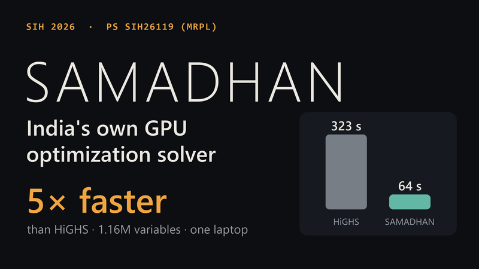
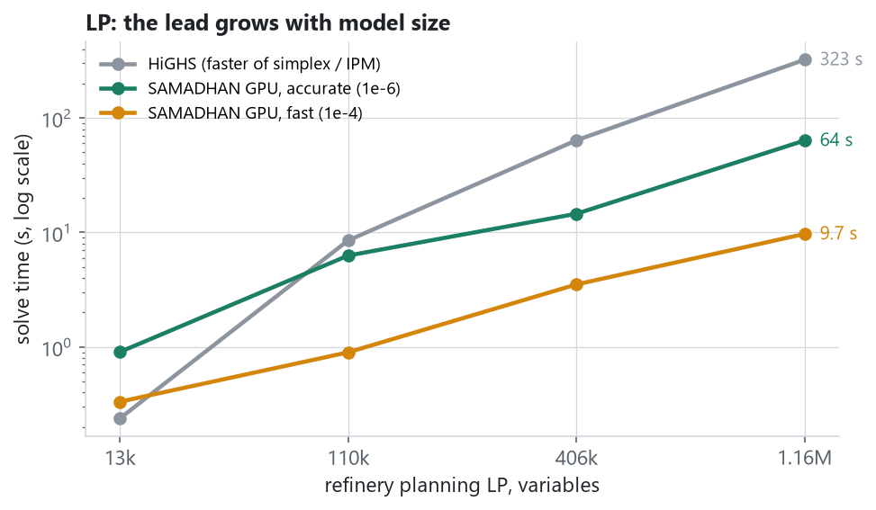
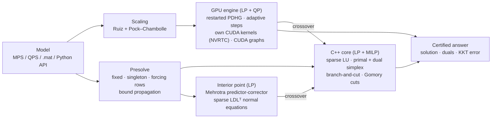
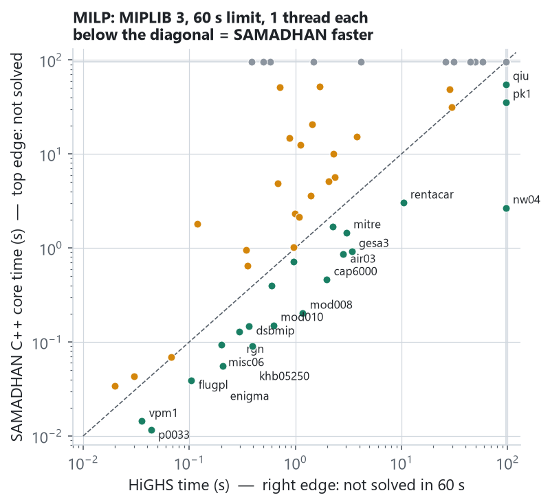
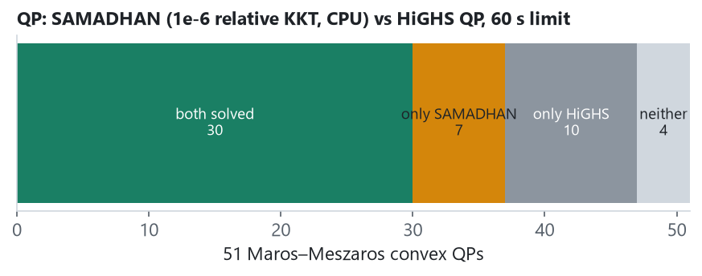

# SAMADHAN — a sovereign optimization solver (LP · QP · MILP), GPU-first

[](https://github.com/NAMAN-THAKUR-1944/SIH2026-SIH26119-SAMADHAN/actions/workflows/tests.yml)
[](LICENSE)


**Smart India Hackathon 2026 · PS SIH26119 (MRPL): *Indigenous GPU-Accelerated Optimization Solver
(Sovereign Alternative to Xpress / CPLEX)* · Team VIGHNAX (127364)**

SAMADHAN (समाधान, "solution") is an optimization solver written from scratch: no CPLEX, Gurobi, Xpress,
HiGHS, CBC or SCIP code inside. It has three engines:

* a **GPU engine for LP and convex QP**: restarted primal-dual hybrid gradient (PDLP / PDQP family), running
  entirely on the GPU on its own fused CUDA C++ kernels and CUDA graphs;
* a **C++17 core for LP and MILP**: presolve, a sparse LU factorisation, primal and dual simplex (exact vertex
  solutions) and branch-and-cut (reliability branching, node domain propagation, Gomory and c-MIR cuts,
  feasibility pump and diving heuristics);
* an **interior-point method for LP** (Mehrotra predictor-corrector, normal equations factorised by the core's
  sparse LDLᵀ).

**Crossover** joins them: an interior-point or GPU solution is turned into an exact optimal vertex by the
simplex. `samadhan solve` picks the engine from the model: MILPs and LPs up to 50k variables go to the C++
core, larger LPs and all QPs to the GPU engine; `--engine ipm` runs the interior-point method with crossover.

HiGHS, the leading open-source solver, is used only as an outside referee for answers and speed.

▶ **3-minute demo video:** [youtu.be/zagX0zqtIeU](https://youtu.be/zagX0zqtIeU) (a real 1.16 M-variable run, the head-to-head with HiGHS, and all benchmark results)

📄 **Idea deck:** [`docs/SAMADHAN_SIH26119_Idea.pdf`](docs/SAMADHAN_SIH26119_Idea.pdf)

🧪 **Check it yourself in 5 minutes:** [two Docker commands](#evaluate-it-in-5-minutes), nothing else to install

❓ **Questions a reviewer will ask** (dependencies, accuracy, fairness of the benchmarks, the comparison with
commercial solvers): [`docs/FAQ.md`](docs/FAQ.md) · 🎤 **Live demo run sheet:** [`docs/DEMO.md`](docs/DEMO.md)

[](https://youtu.be/zagX0zqtIeU)

## Results at a glance

All numbers are measured on one laptop (RTX 5050 Laptop GPU 8 GB), are reproducible with the scripts
below, and are stored in [`results/`](results).

| | What | Result |
|---|---|---|
| **LP** | Refinery planning LP, 1.16 M variables | **6.0× faster** than HiGHS at 1e-6 (cost within 0.0001 %), **35×** at 1e-4 |
| **LP** | Netlib (91 models) | C++ simplex: **91/91 solved** to exact vertices (all within 1e-9 of HiGHS); interior point + crossover: 89/91; GPU engine: 86 to 1e-4; MPS reader identical to HiGHS on 91/91 |
| **MILP** | MIPLIB 3 (all 65 models, 60 s) | **44 proved optimal**, all correct, and a feasible solution on 63; 4 of them HiGHS could not finish (mas76, nw04, pk1, qiu); faster than HiGHS on 19; HiGHS proves 50 |
| **MILP** | MIPLIB 2017 (50 benchmark-set models, 60 s) | 5 proved optimal, all correct, and a feasible solution on 38; HiGHS proves 18 and finds a solution on all 50; on 7 models SAMADHAN's solution is the better one |
| **QP** | Maros–Meszaros (129 convex QPs, 60 s) | **79 solved** to 1e-6 relative KKT (HiGHS 99); all 64 solved by both agree; 15 only SAMADHAN solves |
| **QP** | Refinery QP (convex cost curves) | 13k vars: 78× faster than the HiGHS QP solver; from 110k vars HiGHS does not finish in 600 s, SAMADHAN takes 1.5 s |



## Evaluate it in 5 minutes

Only Docker is needed: no Python, CUDA or compiler. Build the image straight from this repository, then run it:

```bash
docker build -t samadhan https://github.com/NAMAN-THAKUR-1944/SIH2026-SIH26119-SAMADHAN.git
docker run --rm samadhan
```

The build takes a few minutes (it downloads PyTorch and compiles the C++ core). The run is a self-check of
every engine: small LP, QP and MILP models are solved, every answer is compared with HiGHS or with an optimum
worked out by hand, and feasibility is recomputed from the returned solution vector instead of trusting the
solver's own report. Real output on a laptop CPU:

```text
SAMADHAN self-check   GPU engine on CPU   referee: HiGHS 1.15.1

     model                      vars  engine             SAMADHAN      reference            obj. err  infeas.    time
---------------------------------------------------------------------------------------------------------------------
LP   textbook (2 vars)             2  GPU engine              -36            -36  by hand    5.6e-10  0.0e+00   0.02s  PASS
LP   textbook (2 vars)             2  C++ core                -36            -36  by hand    0.0e+00  0.0e+00   0.00s  PASS
LP   refinery planning         1,708  GPU engine        87491.313      87491.468  HiGHS      1.8e-06  1.2e-06   1.40s  PASS
LP   refinery planning         1,708  C++ core          87491.468      87491.468  HiGHS      3.3e-16  9.7e-17   0.02s  PASS
LP   textbook (2 vars)             2  IPM+xover               -36            -36  by hand    0.0e+00  0.0e+00   0.01s  PASS
LP   refinery planning         1,708  IPM+xover         87491.468      87491.468  HiGHS      3.3e-16  1.3e-16   0.06s  PASS
QP   HS21, Maros-Meszaros          2  GPU engine           -99.96         -99.96  by hand    0.0e+00  0.0e+00   0.01s  PASS
QP   refinery, convex costs    1,708  GPU engine        113146.25      113146.25  HiGHS      1.9e-08  5.8e-07   0.89s  PASS
MILP textbook knapsack             2  C++ core                -20            -20  by hand    0.0e+00  0.0e+00   0.00s  PASS
MILP refinery contracts #0       146  C++ core           27531.34       27531.34  HiGHS      1.2e-15  1.1e-15   0.01s  PASS
MILP refinery contracts #1       146  C++ core          23781.574      23781.574  HiGHS      1.5e-16  2.5e-13   0.02s  PASS
MILP refinery contracts #2       146  C++ core          44110.416      44110.416  HiGHS      1.6e-16  2.2e-16   0.00s  PASS

12/12 checks passed in 3.6 s.  obj. err = relative distance to the reference;
infeas. = worst constraint, bound or integrality violation, recomputed here from the solution vector.
```

Then try:

| To see | Run |
|---|---|
| Your own model (the engine is picked from the model) | `docker run --rm -v "$PWD:/models" samadhan solve /models/model.mps` |
| A 110k-variable refinery planning LP (about 10 s on a CPU) | `docker run --rm samadhan demo --size M --device cpu` |
| Refinery planning with crude cargoes and unit modes (MILP, proved optimal in seconds) | `docker run --rm samadhan demo --model plan --size S` |
| Crude oil scheduling at the marine terminal (MILP, 60 s) | `docker run --rm samadhan demo --model crude --size S` |
| The full test suite | `docker run --rm --entrypoint python samadhan -m pytest -q` |

**On an NVIDIA GPU** (Windows: Docker Desktop with the WSL 2 engine; Linux: the NVIDIA Container Toolkit), build
the CUDA image (it needs about 12 GB of disk) and solve the 1.16 M-variable refinery LP:

```bash
docker build --build-arg TORCH_INDEX=https://download.pytorch.org/whl/cu128 -t samadhan:gpu https://github.com/NAMAN-THAKUR-1944/SIH2026-SIH26119-SAMADHAN.git
docker run --rm --gpus all samadhan:gpu demo --size XL --tol 1e-6
```

On the RTX 5050 laptop this took 73.7 s inside Docker and 65.5 s natively when the image was last built, before
the engine had its own CUDA kernels (natively it now takes 54 s), against 323 s for HiGHS.
`docker run --rm --gpus all samadhan:gpu` runs the self-check on the GPU, and the full test suite passes in the GPU
image.

In Windows PowerShell write `${PWD}` instead of `$PWD`. Every number in this README has its raw data in
[`results/`](results) and the command that produced it under [Reproduce every number](#reproduce-every-number).

## Architecture



## Results in detail

### LP — refinery supply-chain planning (MRPL use case)

Crude purchase, CDU capacity, sulfur blending, yields, dispatch and depot inventory. HiGHS is credited with
the faster of its dual simplex and interior point; SAMADHAN with the faster of its two GPU methods.

| Model | Variables | Nonzeros | HiGHS (best) | SAMADHAN accurate (1e-6) | SAMADHAN fast (1e-4) |
|---|---:|---:|---:|---:|---:|
| S | 13,296 | 25,416 | 0.24 s | 0.85 s (0.3×) | 0.32 s (0.7×) |
| M | 109,536 | 214,092 | 8.5 s | 6.3 s (1.4×) | 0.90 s (9.5×) |
| L | 406,080 | 796,512 | 63.9 s | 15.5 s (4.1×) | 3.3 s (19×) |
| XL | 1,157,120 | 2,273,888 | 323 s | 54.0 s (6.0×) | 9.3 s (35×) |

The GPU engine's iteration runs on its own fused CUDA kernels ([How it works](#how-it-works)). Timed in the same
run, the same iterations written with PyTorch operations show what the kernels bring: most where an iteration is
short and twenty small operations dominate it, least on XL, where an iteration is bound by memory bandwidth (the
kernels move data at about 270 GB/s, close to what this laptop GPU can do):

| Model | 1e-6, adaptive: PyTorch → native kernels | 1e-4, best method: PyTorch → native kernels |
|---|---:|---:|
| S | 8.7 s → 3.6 s (2.4×) | 0.79 s → 0.32 s (2.4×) |
| M | 22.9 s → 11.0 s (2.1×) | 1.7 s → 0.90 s (1.9×) |
| L | 24.1 s → 15.5 s (1.6×) | 5.2 s → 3.3 s (1.6×) |
| XL | 72.4 s → 54.0 s (1.3×) | 11.3 s → 9.3 s (1.2×) |

**Netlib** (91 classic LPs, up to 6,071 rows, one thread, 60 s):

| Engine | Solved | Accuracy | Time |
|---|---:|---|---|
| C++ dual simplex (presolve, sparse LU) | **91 / 91** | exact vertices, all within 1e-9 of the HiGHS optimum (worst 1e-10) | median 0.013 s (HiGHS 0.008 s), 24 s for all 91, faster than HiGHS on 8 |
| Interior point + crossover | 89 / 91 | exact vertices, all within 1e-9 (worst 1e-10) | median 21 iterations, 0.11 s; dfl001 and fit2p time out at 120 s (dense normal equations) |
| GPU engine, CPU mode, 1e-4 KKT | 86 / 91 | 80 within 0.1 % | median 1.7 s |

The simplex and the interior-point method also solve the five models the first-order engine cannot (bnl1, greenbea,
greenbeb, perold, pilot4): these ill-conditioned LPs are exactly where second-order and vertex methods are needed.
The hardest, pilot87, now lands within 9e-15 of the optimum with both the simplex and the interior point +
crossover, thanks to scaling and a final pass at 100× tighter tolerances whose result is confirmed on a fresh
factorisation. The Forrest–Tomlin update cut the total time for all 91 from 29 s to 24 s.

### LP — exact vertices from the GPU engine (crossover)

Crossover turns the GPU engine's 1e-4 solution into an exact optimal vertex; every result below equals the
cold-start simplex optimum to 3e-15. It beats the cold start on 9 of the 11 models, among them all three
refinery models (L: 36 s against 673 s, 19×; M: 3.2 s against 52 s), and is slower on maros-r7 and pilot. Two changes
made the difference. A point inside a degenerate optimal face has more columns strictly inside their bounds than
there are rows (refinery-L: 41,195 against 31,536); they used to be put at a bound, now they are pushed there one by
one with a ratio test. And the crash basis used to come from the primal point alone and was far from dual feasible,
so the dual simplex on shifted costs re-solved the LP; now basic variables outside their bounds get the bound
relaxed to their value, the primal simplex finishes the relaxed LP, and the GPU duals guide the crash. Before,
refinery-L took between 583 s and more than 30 minutes depending on the GPU point. The GPU point still matters on
maros-r7: from the point the PyTorch version of the engine reaches, crossover needs 43 iterations (0.2 s); from the
one the native kernels reach, which differs only by rounding, the primal simplex breaks down numerically (its
objective climbs instead of falling) and crossover falls back to a cold start. On greenbea the GPU engine
stopped at its time limit short of 1e-4; crossover still finished exactly from that point:

| Model | Variables | Cold simplex | GPU engine (1e-4) | then crossover | Crossover vs cold |
|---|---:|---:|---:|---:|---:|
| refinery-S | 13,296 | 0.74 s | 0.99 s | 0.10 s | **7.7× faster** |
| refinery-M | 109,536 | 51.6 s | 1.5 s | 3.2 s | **16.0× faster** |
| refinery-L | 406,080 | 673 s | 3.3 s | 36.0 s | **18.7× faster** |
| 25fv47 | 1,571 | 0.12 s | 1.5 s | 0.02 s | **4.9× faster** |
| 80bau3b | 9,799 | 0.43 s | 3.6 s | 0.10 s | **4.4× faster** |
| d2q06c | 5,167 | 0.86 s | 7.0 s | 0.20 s | **4.3× faster** |
| degen3 | 1,818 | 0.26 s | 1.0 s | 0.10 s | **2.5× faster** |
| fit2p | 13,525 | 1.3 s | 2.0 s | 0.09 s | **14.2× faster** |
| maros-r7 | 9,408 | 0.67 s | 0.17 s | 6.8 s | 10.2× slower |
| pilot | 3,652 | 0.90 s | 209 s | 1.9 s | 2.1× slower |
| greenbea | 5,405 | 0.35 s | 300 s | 0.07 s | **4.6× faster** |

### MILP — MIPLIB 3



All 65 MIPLIB 3 models (up to 6,805 rows), 60 s each, one thread each, relative gap 1e-4. **SAMADHAN proves 44
optimal**, every one matching the known optimum, and finds a feasible solution on **63 of 65**; HiGHS proves 50.
SAMADHAN finishes **nw04 (87,482 columns), pk1, qiu and mas76** where HiGHS runs out of time (mas76 only just, in
59.7 s), and is faster than HiGHS on 19 of the models both prove, for example air03 (0.8 s vs 2.8 s), gesa3
(1.1 s vs 3.4 s), cap6000 (0.5 s vs 2.0 s), mod008 (0.2 s vs 1.2 s), mitre (1.2 s vs 3.0 s) and rentacar (2.9 s vs
10.4 s).

How it got here, each step measured on the same models:

| Version | Models run | Proved optimal | With a feasible solution | Shifted geo-mean time |
|---|---:|---:|---:|---:|
| Dense basis inverse (first prototype) | 58 | 26 | — | — |
| Sparse LU, scaling, presolve | 65 | 40 | 56 | 17.7 s |
| + primal heuristics, reliability branching, node propagation, c-MIR cuts | 65 | 40 | 61 | 16.8 s |
| + stronger presolve (dual fixing, free column singletons), faster refactorisation | 65 | 41 | 62 | 16.0 s |
| + Forrest–Tomlin basis update, deterministic refactorisation trigger | 65 | 41 | 62 | 16.5 s |
| + probing, parallel rows, doubleton equations | 65 | 42 | 62 | 15.5 s |
| + fix-and-propagate heuristic | 65 | 42 | 63 | 15.8 s |
| + RINS improvement heuristic | 65 | 43 | 63 | 15.8 s |
| + propagation through continuous columns in presolve | 65 | 44 | 63 | 15.3 s |

The Forrest–Tomlin update targets large LPs; on these small MILPs it is neutral (the counts are unchanged, single
models move both ways as the search takes another path: l152lav 34 s → 8 s, misc07 17 s → 49 s). Since that change,
runs are repeatable: the refactorisation trigger no longer reads a clock. The stronger presolve (probing with
equivalent binaries, parallel rows, doubleton equations) newly solves mitre (2.0 s; probing fixes 4,505 of its
10,724 columns). Probing costs up to a second where it finds nothing, on set partitioning models (air03 0.1 s → 0.8
s); p2756 at first lost the poor incumbent it used to find, and fix-and-propagate (below) now finds it a much better
one (3661, optimum 3,124), and l152lav moves from 8 s to 18 s. RINS (described with the MRPL models below) newly
proves modglob (51 s) and improves the incumbent on 8 of the models that stay unproved, for example p2756 (3,661 →
3,193; optimum 3,124), rout (1,193 → 1,082; HiGHS 1,078), mkc (−502 → −526) and set1ch (54,779 → 54,567); it ends
worse on 4 (mas74, mod011, seymour, swath), and on models that are nearly proved it can cost a few seconds (gesa2_o
9.9 s → 12.9 s). Before it became a default it was compared with the previous defaults back to back on all 65
models: 43 against 42 proved, 63 solutions with both, shifted geo-mean 15.8 s against 15.4 s. The propagation
through continuous columns (written for the crude scheduling model below) changes little here: mas76 is now proved
(59.7 s), the incumbent improves on six models that stay unproved (fixnet6 5,875 → 5,405, swath 646 → 553, mod011,
mkc, p2756, rout) and gets worse on two (air05, harp2). The shifted geo-mean fell from 15.8 s to 15.3 s, partly
because the laptop ran faster in this round: models whose search did not change took 0.88× their earlier time.

The branch-and-cut work finds the first feasible solutions on 10teams, fixnet6, harp2, mkc, p2756 and set1ch,
newly proves 10teams, pp08a and pp08aCUTS, and cuts solve times sharply on many models (gesa2 21 s → 0.9 s, vpm1
14 s → 0.01 s, qnet1 33 s → 19 s, p0548 6.9 s → 2.9 s). The aggregated c-MIR cuts close most of the root gap on
fixed-charge models (pp08a: 17 % of the gap left without them, 3 % with them; set1ch 27 % → 9 %; gesa2 56 % → 25 %).
Two models solved in the first version now stop just short within 60 s (bell5, mas76: incumbent optimal or within
0.006 %, bound not yet closed), and a few results move by tens of percent between runs because heuristic budgets
are time-based (modglob, l152lav). The features were chosen by an ablation over all 65 models; knapsack cover cuts
made things slower on average and are off by default.

**MIPLIB 2017** (50 models of the current benchmark set, 60 s, one thread, gap 1e-4) is much harder, and here HiGHS
is clearly ahead: it proves **18** optimal and finds a solution on all 50; SAMADHAN proves **5** (markshare_4_0,
neos8, nw04, pk1, swath1, all correct; markshare_4_0, nw04 and pk1 are not proved by HiGHS in 60 s) and finds a
solution on 38. On 7 models SAMADHAN ends with the better solution (gen-ip054, mas74, neos-662469, neos-957323,
pg5_34, pk1, rmatr100-p10). RINS improves the incumbent on 14 of the 50 models and ends worse on 7, for example neos-860300
(5,419 → 4,342), timtab1 (1.07 M → 0.99 M) and p200x1188c (18,832 → 15,078, equal to HiGHS); swath3, where
SAMADHAN was ahead, is now 0.4 % behind. Presolve, the gap measured on this set, now probes binaries, merges
parallel rows and substitutes doubleton equations: it matches HiGHS's presolve on 30n20b8 (491 × 4,748 against
488 × 4,733) and graph20-20-1rand, beats it on air05 (343 × 6,119 against 342 × 6,146) and comes close on
neos-860300 and nu25-pr12.
ex9 is still out of reach: its rows are implications x_j ≤ Σ x_k between binaries, which HiGHS's presolve removes
completely by enumerating combinations of short rows; ours keeps 33,766 × 8,560 and its LP relaxation does not
finish in 900 s (HiGHS 12 s). Running this set also found two bugs that are now fixed: integer columns without any
bound in the MPS file must be binary (MIPLIB and HiGHS convention), and a cut round whose LP could not be re-solved
in time is now rolled back instead of ending the solve.

### MILP — MRPL-shaped models

Two models built the way a coastal refinery like MRPL plans and schedules (`samadhan/crude.py`,
`samadhan/generate.py`, `python -m benchmarks.mrpl`), three random instances per size, 60 s, one thread each, gap 1e-4:

* **Crude oil scheduling at the marine terminal.** Vessels arrive over one to two weeks and unload at a single mooring
  into storage tanks that are segregated by crude class (sweet or sour: a tank changes class only when it is down to
  its heel); a tank settles for one 8-hour period after receiving before it may feed a crude unit; each crude unit
  draws from one tank at a time and some units cannot take the sour class. The schedule minimises demurrage, tank
  changeovers, crude-unit starvation and crude left on board.
* **Refinery planning with discrete decisions.** The planning LP of the benchmarks above, with crude bought in whole
  cargoes (0 to 4 parcels per grade and period, each with a freight and port cost) and crude units that are either
  off or run between their minimum and maximum rate, with running and start-up costs.

| Model | Size | Variables (integer) | SAMADHAN: optimal / with a solution | HiGHS: optimal / with a solution | Better solution | Time when both prove optimal |
|---|---|---:|---:|---:|---|---|
| Crude scheduling | S | 1,941 (882) | 0 / 3 of 3 | 1 / 3 of 3 | SAMADHAN 0, HiGHS 3 | — |
| Crude scheduling | M | 5,385 (2,400) | 0 / 3 of 3 | 0 / 3 of 3 | SAMADHAN 0, HiGHS 3 | — |
| Crude scheduling | L | 14,262 (6,552) | 0 / 3 of 3 | 0 / 3 of 3 | SAMADHAN 1, HiGHS 2 | — |
| Refinery planning | S | 1,692 (54) | 3 / 3 of 3 | 3 / 3 of 3 | SAMADHAN 0, HiGHS 0, equal 3 | 2.1 s vs 5.8 s (median) |
| Refinery planning | M | 13,824 (144) | 0 / 3 of 3 | 0 / 3 of 3 | SAMADHAN 0, HiGHS 3 | — |
| Refinery planning | L | 35,976 (192) | 0 / 2 of 3 | 0 / 3 of 3 | SAMADHAN 1, HiGHS 2 | — |

On the small planning model SAMADHAN proves the optimum faster than HiGHS on all three instances. On the larger
planning models neither solver proves optimality in 60 s. SAMADHAN finds a plan on five of the six: three are within
0.4 % of HiGHS's and one large instance is slightly better; the fifth (M, seed 7) ends 5.8 % above HiGHS's in this
round (0.45 % in the previous one: the heuristics' budgets are time-based, so results within the minute move
between runs). On one large instance it finds no plan within the minute.

The crude scheduling model is where HiGHS was clearly stronger, and the reason turned out to be the bound more than
the search. Its LP relaxation is weak (8.75 on medium seed 7, against schedules costing tens of thousands), yet
HiGHS's root bound on that instance is 15,349, before any cut: its domain propagation deduces that a tank holding
more than its heel cannot change crude class in the next period, so its class binary is 1, period after period;
that fixes 2,304 columns and makes the starvation of crude units that cannot take a tank's class unavoidable in
the LP as well. Our presolve tightened bounds only on integer columns, so the chain never started. It now keeps
implied bounds for continuous columns (used only by this propagation, never to declare a row redundant) and sweeps
until nothing changes: on that instance it fixes the same 2,304 columns and reaches the same bound, 15,348. HiGHS
solving with gap 0 gives the same optimum before and after our presolve on all 42 small MIPLIB 3 models and on 11
crude and planning instances.

The search uses two heuristics written for this model. **Fix-and-propagate** finds first schedules: it fixes the
integer columns one by one with domain propagation over all bounds, tries the other side on a conflict, and
completes the point with one LP. **RINS** (relaxation-induced neighbourhood search, Danna, Rothberg & Le Pape)
improves them: the integer columns on which the incumbent and the current LP solution agree are fixed, and the
rest is solved as a small MILP by a nested branch-and-bound, warm-started from the parent's basis, with the
incumbent as cutoff, while the gap exceeds 1 %. With the stronger bound RINS now works on the medium instances too.
The schedule costs in this round, with HiGHS's in brackets:

| Crude scheduling | Seed 7 | Seed 8 | Seed 9 | Before the propagation |
|---|---:|---:|---:|---|
| S | 4,195 (4,095, optimal) | 225 (115) | 420 (275) | 4,450 / 1,585 / 675 |
| M | 29,299 (17,905) | 27,545 (9,722) | 92,404 (815) | 0.38 M / 0.62 M / 0.78 M |
| L | 889,836 (647,923) | **830,736** (884,317) | 872,225 (738,807) | 374,541 / 910,373 / none |

HiGHS is still ahead on eight of the nine, far ahead on medium seed 9, where our bound stays weak (about 9, as on
medium seed 8 and all large instances). On the large instances SAMADHAN at first found no schedule at all, because
the root LP did not finish: integer columns are not scaled (so that integrality is unchanged), and with this
model's big-M coefficients (up to 499) that cost the dual simplex 12 (m + n) iterations instead of 0.9 (m + n) fully
scaled. A root LP that has taken 1.5 (m + n) iterations now continues on a copy of the model with every column
scaled, from the basis where it stopped, and hands the optimal basis back (scaling does not change which columns
are basic); every MIPLIB 3 root LP and every other MRPL-shaped one needs at most 1.3 (m + n) iterations and keeps
exactly its path. All three large instances now get a schedule, one cheaper than HiGHS's; seed 7 ended at 374,541
in the previous round and at 889,836 in this one, a reminder that results within a minute move with the timing of
the heuristics.

### QP — Maros–Meszaros and refinery QP



The same GPU engine solves convex QPs (`0.5 x'Qx + c'x`) by adding the gradient `Qx` to the primal step.
**Maros–Meszaros** (129 convex QPs, CPU mode, 60 s, one thread each): SAMADHAN solves **79** to 1e-6
relative KKT and the HiGHS QP solver 99. All **64** solved by both agree to 1e-4. SAMADHAN solves **15** that
HiGHS does not (HiGHS reports a solve error, no status or a time-out, e.g. AUG2D, LASER, MOSARQP1, QSCTAP3),
and HiGHS crashes on STADAT1. HiGHS solves 35 that SAMADHAN does not finish in 60 s: ill-conditioned problems
where a first-order method needs many more iterations or a crossover step.

**Refinery QP** (every activity has a convex cost curve: crude supply, processing, freight congestion,
holding and shortage), GPU, 1e-6 relative KKT. HiGHS's QP solver is an active-set method:

| Model | Variables | HiGHS QP | SAMADHAN GPU (1e-6) | Cost check |
|---|---:|---:|---:|---|
| S | 13,296 | 86.3 s | 1.1 s (78×) | 0.00016 % from HiGHS |
| M | 109,536 | > 600 s (not solved) | 1.5 s (> 402×) | certified by KKT (1e-6) |
| L | 406,080 | > 1660 s (not solved) | 5.1 s (> 323×) | certified by KKT (1e-6) |
| XL | 1,157,120 | not attempted ¹ | 19.9 s (—) | certified by KKT (1e-6) |

¹ HiGHS was given 600 s per model; on L it stopped only after 1,660 s without a solution, so XL was not attempted.

## Honest limitations

* On small LPs HiGHS's simplex is still a little faster than ours (Netlib median 0.008 s against
  0.013 s, part of it Python-side presolve); the GPU engine pays off from roughly 100k variables.
* The GPU engine reaches 1e-4…1e-6 relative accuracy. Crossover turns its solution into an exact vertex and beats a
  cold start on 9 of 11 test models, but it is still slower on maros-r7 and pilot (from some GPU points the primal
  simplex breaks down numerically and a cold start takes over), and the 1.16 M-variable refinery LP
  has not been crossed over yet (roadmap).
* The interior-point method factorises A Θ Aᵀ directly: models with dense columns (fit2p) are slow, as there is
  no dense-column splitting yet.
* On the crude scheduling MILP (MRPL marine terminal) HiGHS still finds cheaper schedules within 60 s on eight of
  nine instances: 1.0–2× cheaper on the small ones, 1.6–2.8× on two medium ones and 113× on the third, whose LP
  bound stays weak after our presolve; on the large ones SAMADHAN's schedules are within 1.4× of HiGHS's and one
  is cheaper. There is no local branching yet.
* Presolve has the standard primal reductions, dual fixing, parallel rows, doubleton substitution and probing,
  but no clique table or enumeration of small rows yet (HiGHS's presolve removes all of ex9 that way), and no
  dominated or duplicate columns or coefficient strengthening. The branch-and-cut root bound is still weaker than
  HiGHS's on some models (no lifted cover or multi-row flow-cover cuts: p2756, fixnet6), and strong branching
  costs time on models with very cheap LPs (misc07). One thread.

## Install without Docker

```bash
python -m venv .venv
.venv/Scripts/pip install torch --index-url https://download.pytorch.org/whl/cu128   # or /whl/cpu
.venv/Scripts/pip install -r requirements.txt
.venv/Scripts/python -m samadhan verify                         # self-check of every engine, ~10 s
.venv/Scripts/python -m pytest                                  # 71 correctness tests, ~45 s
.venv/Scripts/python -m samadhan demo --size XL --tol 1e-6      # 1.16M-variable refinery LP on the GPU
.venv/Scripts/python -m samadhan solve model.mps                # engine picked from the model
.venv/Scripts/python -m samadhan solve model.mps --engine core  # force the C++ dual simplex / branch-and-cut
.venv/Scripts/python -m samadhan solve model.mps --engine ipm   # interior point + crossover to a vertex
```

```python
from samadhan import read_mps, solve, solve_core, solve_ipm

lp = read_mps("model.mps")
print(solve(lp, device="cuda", tol=1e-6).primal_obj)        # GPU engine: LP, or QP when lp.Q is set
print(solve(lp, tol=1e-4, crossover=True).primal_obj)       # GPU engine + crossover: exact vertex (LP)
print(solve_ipm(lp, crossover=True).primal_obj)             # interior point + crossover (LP)
print(solve_core(lp, time_limit=60).obj)                    # C++ core: LP or MILP (integer markers in the file)
```

**From PuLP or Pyomo.** Existing models need one line changed (`pip install pulp pyomo`, optional):

```python
import pulp
from samadhan.pulp_solver import SAMADHAN
prob.solve(SAMADHAN(msg=False, timeLimit=60))               # LP or MILP; engine="gpu" / "ipm" for large LPs

import pyomo.environ as pyo
import samadhan.pyomo_solver                                # registers "samadhan" with Pyomo
pyo.SolverFactory("samadhan").solve(model, timelimit=60)    # values are loaded into the model's variables
```

Both plugins hand the model to the same engines as above and return the solution, status and bound in the
modelling layer's own terms; on a small crude-selection model with binaries, integers, ranged rows and a maximised
objective both give the HiGHS optimum and values (`tests/test_samadhan.py`). A complete, readable example (crude
cargoes, a crude unit that runs or not, a sulfur limit): `python -m examples.pulp_crude_selection`
([`examples/pulp_crude_selection.py`](examples/pulp_crude_selection.py)).

The C++ core is compiled automatically on first use with the zig toolchain (installed from PyPI with the
requirements), so no system compiler is needed. CI lints the code, builds the core and runs the tests on
Ubuntu and Windows for every push, and builds the Docker image and runs the self-check inside it.

## Reproduce every number

Run from the repository root; each script writes the raw results used in this README.

```bash
python -m benchmarks.lp                  # refinery LP table              -> results/lp_refinery.json
python -m benchmarks.milp                # refinery MILPs, both engines   -> results/milp_refinery.json
git clone https://github.com/coin-or-tools/Data-Netlib  data/netlib
python -m benchmarks.netlib              # Netlib LPs, GPU engine         -> results/lp_netlib.json
python -m benchmarks.netlib --engine core   # Netlib LPs, C++ simplex     -> results/lp_netlib_core.json
python -m benchmarks.netlib --engine ipm    # Netlib LPs, IPM + crossover -> results/lp_netlib_ipm.json
python -m benchmarks.crossover --with-L     # cold simplex vs crossover    -> results/lp_crossover.json
git clone https://github.com/coin-or-tools/Data-miplib3 data/miplib3
python -m benchmarks.miplib              # MIPLIB 3                       -> results/milp_miplib3.json
python -m benchmarks.miplib --set miplib2017   # 50 MIPLIB 2017 models     -> results/milp_miplib2017.json
python -m benchmarks.mrpl                # MRPL-shaped MILPs (generated) -> results/milp_mrpl.json
# (the .mps.gz files of the models listed in benchmarks/miplib.py, from miplib.zib.de/WebData/instances/)
# Maros-Meszaros .mat files (< 300 KB) from github.com/qpsolvers/maros_meszaros_qpbenchmark -> data/maros/
python -m benchmarks.qp maros            # Maros-Meszaros QPs             -> results/qp_maros.json
python -m benchmarks.qp refinery --time-limit 600   # refinery QP (GPU)  -> results/qp_refinery.json
python docs/make_figures.py              # the figures above
```

## Project layout

```
samadhan/            the solver package
  pdlp.py            GPU engine for LP and QP (restarted PDHG, adaptive and CUDA-graph modes)
  cuda_kernels.py    the GPU engine's fused CUDA C++ kernels, compiled at run time by NVRTC
  core.py            binding for the C++ core; compiles it with zig on first use
  mps.py, qpdata.py  model readers: MPS (free / fixed format, RANGES, OBJSENSE, integer markers), Maros-Meszaros .mat
  simplex.py, milp.py  pure-Python reference simplex and branch-and-bound, used to cross-check the C++ core
  presolve.py        presolve and postsolve for the C++ core (LP and MILP)
  ipm.py             interior-point method (Mehrotra) with crossover
  generate.py        refinery planning LP / QP / MILP generators
  crude.py           crude oil scheduling MILP of a marine terminal (MRPL-shaped)
  pulp_solver.py     PuLP plugin (SAMADHAN solver class)
  pyomo_solver.py    Pyomo plugin (SolverFactory("samadhan"))
  baseline.py        HiGHS referee (LP, QP, MILP), used only for benchmarks and tests
  verify.py          self-check: python -m samadhan verify
  __main__.py        command line: python -m samadhan
cpp/samadhan_core.cpp  C++17 dual simplex and branch-and-cut (C ABI)
Dockerfile           CPU image by default; CUDA image with --build-arg TORCH_INDEX=.../whl/cu128
benchmarks/          one script per benchmark; results/ holds their raw JSON output
tests/               pytest suite: every component checked against HiGHS or a hand-computed optimum
docs/                idea deck (PDF), FAQ, live demo run sheet, figures and the script that draws them
examples/            a crude-selection MILP written in PuLP and solved by SAMADHAN
```

## How it works

* **LP / QP (GPU).** Restarted PDHG (Applegate et al., NeurIPS 2021; Lu & Yang, cuPDLP 2023) with Ruiz and
  Pock–Chambolle scaling, adaptive step sizes, primal-weight updates and KKT-based restarts. A constant-step
  variant has no host synchronisation between checks, so 64 iterations are captured once as a CUDA graph and
  replayed with one launch. For LPs the iteration runs on our own **CUDA C++ kernels**
  (`samadhan/cuda_kernels.py`), compiled at run time by NVRTC, the compiler library that ships with PyTorch, so no
  CUDA toolkit is needed: one iteration is three fused kernels (the primal step with its averaging; `K x` fused
  with the dual step; `Kᵀy`) instead of about twenty PyTorch operations, each sparse row summed by a small group
  of threads in a fixed order, so runs repeat exactly. In the adaptive method the candidate step goes to separate
  buffers, the three inner products of the step-size rule come from per-block partial sums, and the averaging of
  an accepted step is folded into the next step's kernels. For QP the primal step uses `Qx + c − Kᵀy` with
  `τ ≤ 1/(‖Q‖/2 + σ‖K‖²)` (linearised PDHG, as in PDQP) and the Wolfe dual for the gap.
* **Interior point.** Mehrotra predictor-corrector on the standard form `Ax = b, 0 ≤ x ≤ u` (free columns
  kept, with a small primal regularisation), after Ruiz scaling. Each iteration forms `A Θ Aᵀ`, scales it to a
  unit diagonal and factorises it once with the C++ sparse LU in symmetric mode (diagonal pivots in
  minimum-degree order, i.e. LDLᵀ), then solves twice with iterative refinement.
* **Crossover.** From an interior or GPU point and its duals: crash basis from the columns strictly inside
  their bounds, ranked by the indicator p / (p + |d|) (p the distance to the nearer bound, d the reduced cost of
  the given duals), so the basis is close to dual feasible. A point inside a degenerate optimal face has more
  such columns than there are rows; the rest stay at their values as superbasics and are pushed to a bound one
  by one (a blocking basic variable swaps with the column). Basic variables outside their bounds get the violated
  bound relaxed to their value, the primal simplex reaches the optimum of that relaxed LP, and after the bounds
  are restored the dual simplex finishes; a final pass runs at 100× tighter tolerances. If the primal phase
  fails, a dual simplex on perturbed shifted costs takes over, and if the crossover is slower than a cold start
  it hands over to one, so the answer is always an exact vertex.
* **Presolve.** Before the C++ core runs, the model is reduced until a pass changes nothing: fixed and empty
  columns are removed, singleton rows become bounds, rows that their activity bounds already satisfy are
  dropped, forcing rows fix their columns, integer columns get tighter bounds from the rows (domain
  propagation, swept until nothing changes; continuous columns carry implied bounds that serve only this
  propagation, so a deduction travels along chains such as tank inventories from period to period), columns
  that neither their cost nor any row pushes upwards are fixed at a bound (dual fixing),
  continuous columns that sit in a single equality row which already implies their bounds are substituted out
  (free column singletons), parallel rows are merged, and doubleton equations a_j x_j + a_k x_k = b substitute a
  continuous x_k out. When none of this finds more, probing (C++) fixes every binary at 0 and at 1 in turn and
  propagates: an impossible value fixes the column, bounds implied by both values are kept, and a binary that
  follows another both ways is replaced by it. Probing effort is a work budget (row entries visited), so the
  result does not depend on the machine. Substituted columns are recovered in postsolve; the solution is mapped
  back to the original columns and checked against the original rows.
* **LP / MILP (C++).** Every row gets a logical variable, so the simplex works on `[A −I]` with column
  bounds, after geometric-mean scaling and equilibration (powers of two; integer columns keep the factor 1, and a
  MILP root LP that is slow because of that continues on a fully scaled copy). The basis is held as a sparse LU
  factorisation: Markowitz pivot order with threshold pivoting, Forrest–Tomlin updates between
  refactorisations (the transformed entering column replaces its column of U, and one short row eta restores
  the triangular form; an update that loses accuracy triggers a refactorisation), a refactorisation trigger
  that weighs the update work against a counted factorisation cost (deterministic, so runs repeat exactly),
  and repair of singular bases with logical columns. Bounded dual simplex with dual
  steepest-edge pricing (Forrest–Goldfarb weight updates), a Harris ratio test and row-wise pricing when the
  pivot row is sparse. Branch-and-bound dives from each node keep the factorisation (a bound change on a basic
  variable keeps the basis dual feasible); other nodes store a 2-bit-per-column basis for a warm restart.
  Root cuts: Gomory mixed-integer cuts from the tableau and aggregated c-MIR cuts (Marchand & Wolsey: up to six
  rows combined to eliminate continuous columns, variable upper bounds x ≤ u·y substituted, the best of several
  scalings rounded); knapsack cover cuts are available, off by default. Primal heuristics:
  rounding, a feasibility pump (objective variant, with cycle flips and perturbation) at the root,
  fix-and-propagate (integer columns fixed one by one with propagation over all bounds, completed by one LP), and
  fractional / guided diving at the root and periodically in the tree, all within 10 % of the time limit; RINS
  (the integer columns on which incumbent and LP solution agree are fixed and the rest is solved by a nested
  branch-and-bound with the incumbent as cutoff) at the root and in the tree while the gap exceeds 1 %, within its
  own 30 %; with an incumbent, reduced-cost fixing tightens the global bounds. Reliability branching seeds pseudocosts by
  strong branching (25 dual simplex iterations per child, at most half of all LP work), and every node runs
  activity-based domain propagation that prunes infeasible nodes before their LP. Each feature can be switched
  off (`solve_core(..., features=)`); the defaults were chosen by an ablation over MIPLIB 3.

## Roadmap (SIH build phase)

1. Crossover at a million variables (the 1.16 M refinery LP); dense columns in the interior-point method.
2. Local branching and lighter RINS sub-MIPs for large scheduling models; clique table and enumeration presolve
   (ex9), dominated and duplicate columns; lifted cover and flow-cover cuts; parallel tree search.
3. GPU LP relaxations inside branch-and-bound for very large MILPs; MIQP.
4. Native CUDA kernels for the PDHG loop; REST service for plant planning systems.

## Team and license

Team VIGHNAX (127364), SRM University, for Smart India Hackathon 2026. Each member owns one part of the solver and
answers for it:

| Member | Module | Files |
|---|---|---|
| Naman Thakur (lead) | architecture; C++ LP core: sparse LU, Forrest–Tomlin update, simplex, crossover | `cpp/samadhan_core.cpp` (LP), `samadhan/core.py` |
| Sayom Shani | GPU engine: PDLP / PDQP, native CUDA kernels, CUDA graphs | `samadhan/pdlp.py`, `samadhan/cuda_kernels.py` |
| Lahari | presolve, probing, model readers | `samadhan/presolve.py`, `samadhan/mps.py`, `samadhan/qpdata.py` |
| Avinash | branch-and-cut: cuts, branching, heuristics (pump, diving, fix-and-propagate, RINS) | `cpp/samadhan_core.cpp` (MILP) |
| Rajat Goel | interior point, verification, tests, CI, Docker | `samadhan/ipm.py`, `samadhan/verify.py`, `tests/`, `Dockerfile` |
| Manit Thakur | MRPL models, PuLP / Pyomo plugins, benchmarks, demo | `samadhan/crude.py`, `samadhan/generate.py`, `samadhan/*_solver.py`, `benchmarks/` |

Licensed under [Apache-2.0](LICENSE).
