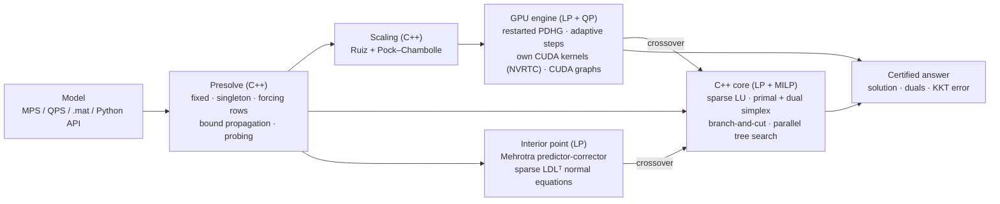

# SAMADHAN — a sovereign optimization solver (LP · QP · MILP), GPU-first

[](https://github.com/NAMAN-THAKUR-1944/SIH2026-SIH26119-SAMADHAN/actions/workflows/tests.yml)
[](LICENSE)


**Smart India Hackathon 2026 · PS SIH26119 (MRPL): *Indigenous GPU-Accelerated Optimization Solver
(Sovereign Alternative to Xpress / CPLEX)* · Team VIGHNAX (127364)**

SAMADHAN (समाधान, "solution") is an optimization solver written from scratch: no CPLEX, Gurobi, Xpress,
HiGHS, CBC or SCIP code inside. It has three engines:

* a **GPU engine for LP and convex QP**: restarted primal-dual hybrid gradient (PDLP / PDQP family), running
  entirely on the GPU on its own fused CUDA C++ kernels and CUDA graphs;
* a **C++17 core for LP and MILP**: presolve, a sparse LU factorisation, primal and dual simplex (exact vertex
  solutions) and branch-and-cut (reliability branching, node domain propagation, Gomory, c-MIR, flow cover and
  network cut-set cuts, feasibility pump, diving, fix-and-propagate, RINS and local branching heuristics, a
  deterministic parallel tree search);
* an **interior-point method for LP** (Mehrotra predictor-corrector, normal equations factorised by the core's
  sparse LDLᵀ).

**Crossover** joins them: an interior-point or GPU solution is turned into an exact optimal vertex by the
simplex. `samadhan solve` picks the engine from the model: MILPs and LPs up to 50k variables go to the C++
core, larger LPs and all QPs to the GPU engine; `--engine ipm` runs the interior-point method with crossover.

HiGHS, the leading open-source solver, is used only as an outside referee for answers and speed.

▶ **3-minute demo video:** [youtu.be/zagX0zqtIeU](https://youtu.be/zagX0zqtIeU) (a real 1.16 M-variable run, the head-to-head with HiGHS, and all benchmark results)

📄 **Idea deck:** [`docs/SAMADHAN_SIH26119_Idea.pdf`](docs/SAMADHAN_SIH26119_Idea.pdf)

🧪 **Check it yourself in 5 minutes:** [two Docker commands](#evaluate-it-in-5-minutes), nothing else to install

❓ **Questions a reviewer will ask** (dependencies, accuracy, fairness of the benchmarks, the comparison with
commercial solvers): [`docs/FAQ.md`](docs/FAQ.md) · 🎤 **Live demo run sheet:** [`docs/DEMO.md`](docs/DEMO.md)

[](https://youtu.be/zagX0zqtIeU)

## Results at a glance

All numbers are measured on one laptop (RTX 5050 Laptop GPU 8 GB), are reproducible with the scripts
below, and are stored in [`results/`](results). The current round (2026-10-15/16) found that Windows 11 runs
processes without a window of their own — benchmark workers started from a shell — as background work on the
efficiency cores at low clock while the desktop is in use: the same MILP search took 4.4 s at full speed and 14.8 s
throttled. Every solver process, SAMADHAN's and HiGHS's alike, now opts out of that throttling (its own setting
only), a fixed speed check ran before and after every benchmark, the load from other programs was logged
throughout, and runs that overlapped heavy outside load were repeated.

| | What | Result |
|---|---|---|
| **LP** | Refinery planning LP, 1.16 M variables | **5.1× faster** than HiGHS at 1e-6 (cost within 0.0002 %), **33×** at 1e-4; an **exact optimal vertex in 91 s** (GPU + crossover) against HiGHS's 323 s |
| **LP** | 14 Mittelmann LPfeas instances against NVIDIA cuOpt (GPU, 1e-4) | **faster than cuOpt on 7 of 14** (cuOpt on the other 7); SAMADHAN solves 12, cuOpt 14; objectives within 7e-4 of cuOpt's; HiGHS proves 5 of 14 in 300 s |
| **LP** | Netlib (91 models) | C++ simplex: **91/91 solved** to exact vertices (all within 1e-9 of HiGHS); interior point + crossover: 89/91; GPU engine: 86 to 1e-4; MPS reader identical to HiGHS on 91/91 |
| **MILP** | MIPLIB 3 (all 65 models, 60 s) | **45 proved optimal**, all correct, and a feasible solution on 63; 2 of them HiGHS could not finish (arki001, pk1); faster than HiGHS on 20 of 43 (nw04: 2.4 s against 50.5 s); HiGHS proves 51 |
| **MILP** | MIPLIB 2017 (50 benchmark-set models, 60 s) | 8 proved optimal (was 5), all correct (beasleyC3 13× faster than HiGHS), and a feasible solution on 37; HiGHS proves 20 and finds a solution on all 50; on 5 models SAMADHAN's solution is the better one |
| **MILP** | Parallel tree search, MIPLIB 3 (60 s, each model alone) | 1 → 4 → 8 threads: 46 → 47 → 45 proved optimal; **1.8×** and **2.0×** faster on the 21 models all three prove; the same tree on every run (deterministic) |
| **QP** | Maros–Meszaros (129 convex QPs, 60 s) | **79 solved** to 1e-6 relative KKT (HiGHS 99); all 64 solved by both agree; 15 only SAMADHAN solves |
| **QP** | Refinery QP (convex cost curves) | 13k vars: 78× faster than the HiGHS QP solver; from 110k vars HiGHS does not finish in 600 s, SAMADHAN takes 1.5 s |


## Evaluate it in 5 minutes

Only Docker is needed: no Python, CUDA or compiler. Build the image straight from this repository, then run it:

```bash
docker build -t samadhan https://github.com/NAMAN-THAKUR-1944/SIH2026-SIH26119-SAMADHAN.git
docker run --rm samadhan
```

The build takes a few minutes (it downloads PyTorch and compiles the C++ core). The run is a self-check of
every engine: small LP, QP and MILP models are solved, every answer is compared with HiGHS or with an optimum
worked out by hand, and feasibility is recomputed from the returned solution vector instead of trusting the
solver's own report. Real output on a laptop CPU:

```text
SAMADHAN self-check   GPU engine on CPU   referee: HiGHS 1.15.1

     model                      vars  engine             SAMADHAN      reference            obj. err  infeas.    time
---------------------------------------------------------------------------------------------------------------------
LP   textbook (2 vars)             2  GPU engine              -36            -36  by hand    5.6e-10  0.0e+00   0.02s  PASS
LP   textbook (2 vars)             2  C++ core                -36            -36  by hand    0.0e+00  0.0e+00   0.00s  PASS
LP   refinery planning         1,708  GPU engine        87491.313      87491.468  HiGHS      1.8e-06  1.2e-06   1.40s  PASS
LP   refinery planning         1,708  C++ core          87491.468      87491.468  HiGHS      3.3e-16  9.7e-17   0.02s  PASS
LP   textbook (2 vars)             2  IPM+xover               -36            -36  by hand    0.0e+00  0.0e+00   0.01s  PASS
LP   refinery planning         1,708  IPM+xover         87491.468      87491.468  HiGHS      3.3e-16  1.3e-16   0.06s  PASS
QP   HS21, Maros-Meszaros          2  GPU engine           -99.96         -99.96  by hand    0.0e+00  0.0e+00   0.01s  PASS
QP   refinery, convex costs    1,708  GPU engine        113146.25      113146.25  HiGHS      1.9e-08  5.8e-07   0.89s  PASS
MILP textbook knapsack             2  C++ core                -20            -20  by hand    0.0e+00  0.0e+00   0.00s  PASS
MILP refinery contracts #0       146  C++ core           27531.34       27531.34  HiGHS      1.2e-15  1.1e-15   0.01s  PASS
MILP refinery contracts #1       146  C++ core          23781.574      23781.574  HiGHS      1.5e-16  2.5e-13   0.02s  PASS
MILP refinery contracts #2       146  C++ core          44110.416      44110.416  HiGHS      1.6e-16  2.2e-16   0.00s  PASS

12/12 checks passed in 3.6 s.  obj. err = relative distance to the reference;
infeas. = worst constraint, bound or integrality violation, recomputed here from the solution vector.
```

Then try:

| To see | Run |
|---|---|
| Your own model (the engine is picked from the model) | `docker run --rm -v "$PWD:/models" samadhan solve /models/model.mps` |
| A 110k-variable refinery planning LP (about 10 s on a CPU) | `docker run --rm samadhan demo --size M --device cpu` |
| Refinery planning with crude cargoes and unit modes (MILP, proved optimal in seconds) | `docker run --rm samadhan demo --model plan --size S` |
| Crude oil scheduling at the marine terminal (MILP, 60 s) | `docker run --rm samadhan demo --model crude --size S` |
| The full test suite | `docker run --rm --entrypoint python samadhan -m pytest -q` |

**On an NVIDIA GPU** (Windows: Docker Desktop with the WSL 2 engine; Linux: the NVIDIA Container Toolkit), build
the CUDA image (it needs about 12 GB of disk) and solve the 1.16 M-variable refinery LP:

```bash
docker build --build-arg TORCH_INDEX=https://download.pytorch.org/whl/cu128 -t samadhan:gpu https://github.com/NAMAN-THAKUR-1944/SIH2026-SIH26119-SAMADHAN.git
docker run --rm --gpus all samadhan:gpu demo --size XL --tol 1e-6
```

On the RTX 5050 laptop this took 57.7 s inside Docker and 54.0 s natively in the previous round, with the same 62,912
iterations (the
CUDA kernels are compiled inside the container by the NVRTC that comes with PyTorch), against 323 s for HiGHS.
`docker run --rm --gpus all samadhan:gpu` runs the self-check on the GPU, and the full test suite passes in the GPU
image.

In Windows PowerShell write `${PWD}` instead of `$PWD`. Every number in this README has its raw data in
[`results/`](results) and the command that produced it under [Reproduce every number](#reproduce-every-number).

## Architecture



## Results in detail

### LP — refinery supply-chain planning (MRPL use case)

Crude purchase, CDU capacity, sulfur blending, yields, dispatch and depot inventory. HiGHS is credited with
the faster of its dual simplex and interior point; SAMADHAN with the faster of its two GPU methods.

| Model | Variables | Nonzeros | HiGHS (best) | SAMADHAN accurate (1e-6) | SAMADHAN fast (1e-4) |
|---|---:|---:|---:|---:|---:|
| S | 13,296 | 25,416 | 0.24 s | 0.90 s (0.3×) | 0.33 s (0.7×) |
| M | 109,536 | 214,092 | 8.5 s | 6.3 s (1.4×) | 0.90 s (9.5×) |
| L | 406,080 | 796,512 | 63.9 s | 14.6 s (4.4×) | 3.5 s (18×) |
| XL | 1,157,120 | 2,273,888 | 323 s | 63.7 s (5.1×) | 9.7 s (33×) |

In the previous round XL at 1e-6 took 54.0 s: the adaptive method's iteration count depends on the last bits of the
scaled model, and the scaling, now computed in C++, differs from the old Python version in those bits (62,912
iterations then, 73,472 now); the fixed-step graph method runs exactly the same iterations as before in the same
time.

The GPU engine's iteration runs on its own fused CUDA kernels ([How it works](#how-it-works)). Timed in the same
run, the same iterations written with PyTorch operations show what the kernels bring: most where an iteration is
short and twenty small operations dominate it, least on XL, where an iteration is bound by memory bandwidth (the
kernels move data at about 270 GB/s, close to what this laptop GPU can do). The first column uses the graph method,
which runs the same iterations both ways, so it compares the cost per iteration alone:

| Model | 1e-6, graph method: PyTorch → native kernels | 1e-4, best method: PyTorch → native kernels |
|---|---:|---:|
| S | 1.99 s → 0.90 s (2.2×) | 0.70 s → 0.33 s (2.1×) |
| M | 12.1 s → 6.3 s (1.9×) | 1.70 s → 0.90 s (1.9×) |
| L | 37.3 s → 31.3 s (1.2×) | 4.46 s → 3.52 s (1.3×) |
| XL | 136.5 s → 127.7 s (1.07×) | 12.5 s → 9.7 s (1.3×) |

**Netlib** (91 classic LPs, up to 6,071 rows, one thread, 60 s):

| Engine | Solved | Accuracy | Time |
|---|---:|---|---|
| C++ dual simplex (presolve, sparse LU) | **91 / 91** | exact vertices, all within 1e-9 of the HiGHS optimum (worst 1e-10) | median 0.013 s (HiGHS 0.008 s), 24 s for all 91, faster than HiGHS on 8 |
| Interior point + crossover | 89 / 91 | exact vertices, all within 1e-9 (worst 1e-10) | median 21 iterations, 0.11 s; dfl001 and fit2p time out at 120 s (dense normal equations) |
| GPU engine, CPU mode, 1e-4 KKT | 86 / 91 | 80 within 0.1 % | median 1.7 s |

The simplex and the interior-point method also solve the five models the first-order engine cannot (bnl1, greenbea,
greenbeb, perold, pilot4): these ill-conditioned LPs are exactly where second-order and vertex methods are needed.
The hardest, pilot87, now lands within 9e-15 of the optimum with both the simplex and the interior point +
crossover, thanks to scaling and a final pass at 100× tighter tolerances whose result is confirmed on a fresh
factorisation. The Forrest–Tomlin update cut the total time for all 91 from 29 s to 24 s.

### LP — exact vertices from the GPU engine (crossover)

Crossover turns the GPU engine's 1e-4 solution into an exact optimal vertex; every result below equals the
cold-start simplex optimum to 5e-15. It beats the cold start on 10 of the 11 models, among them all three
refinery models (L: 30 s against 673 s, 23×; M: 3.1 s against 51 s), and is slower only on pilot. Two changes
made the difference. A point inside a degenerate optimal face has more columns strictly inside their bounds than
there are rows (refinery-L: 41,195 against 31,536); they used to be put at a bound, now they are pushed there one by
one with a ratio test. And the crash basis used to come from the primal point alone and was far from dual feasible,
so the dual simplex on shifted costs re-solved the LP; now basic variables outside their bounds get the bound
relaxed to their value, the primal simplex finishes the relaxed LP, and the GPU duals guide the crash. Before,
refinery-L took between 583 s and more than 30 minutes depending on the GPU point. The GPU point still matters on
pilot, and it mattered on maros-r7: from some points, which differ from others only by rounding, the primal simplex
breaks down numerically (its objective climbs instead of falling) and crossover falls back to a cold start. That is
what happens on pilot (1.9 s against 0.9 s); maros-r7, which took 6.8 s that way in the previous round, now starts
from a point where it does not and finishes in 0.43 s. On greenbea the GPU engine stopped at its time limit short of
1e-4; crossover still finished exactly from that point:

| Model | Variables | Cold simplex | GPU engine (1e-4) | then crossover | Crossover vs cold |
|---|---:|---:|---:|---:|---:|
| refinery-S | 13,296 | 0.70 s | 0.90 s | 0.07 s | **9.4× faster** |
| refinery-M | 109,536 | 51.3 s | 1.2 s | 3.1 s | **16.7× faster** |
| refinery-L | 406,080 | 673 s | 3.6 s | 29.9 s | **22.5× faster** |
| 25fv47 | 1,571 | 0.11 s | 1.4 s | 0.01 s | **8.0× faster** |
| 80bau3b | 9,799 | 0.41 s | 3.4 s | 0.05 s | **8.2× faster** |
| d2q06c | 5,167 | 0.87 s | 7.4 s | 0.13 s | **6.7× faster** |
| degen3 | 1,818 | 0.27 s | 1.1 s | 0.10 s | **2.7× faster** |
| fit2p | 13,525 | 1.2 s | 2.4 s | 0.05 s | **23.2× faster** |
| maros-r7 | 9,408 | 0.64 s | 0.17 s | 0.43 s | **1.5× faster** |
| pilot | 3,652 | 0.92 s | 232 s | 1.9 s | 2.1× slower |
| greenbea | 5,405 | 0.34 s | 300 s | 0.04 s | **7.6× faster** |
| refinery-XL | 1,157,120 | not attempted ¹ | 63.2 s (to 1e-6) | 27.2 s | 91 s in all; HiGHS 323 s |

¹ HiGHS's interior point with its own crossover takes 323 s on XL; a cold-start dual simplex was not run, as on L
it already needs 673 s.

**The 1.16 M-variable refinery LP now crosses over too.** The first attempt ran for more than 29 minutes before it
was stopped. Most of that time went into pushing the superbasic columns to their bounds, which scanned all rows for
every column; it now touches only the rows of each column's entries and takes 14 s. The primal simplex that follows
is the expensive part: on this model most pivot rows are dense, so each iteration costs time in proportion to the
columns. From the GPU's 1e-4 point that took 310–360 s (31,000 primal iterations). From a 1e-6 point the GPU needs
63 s instead of 10 s, but crossover needs only 27 s, so an exact optimal vertex of the XL model takes about 91 s, 3.6×
faster than HiGHS. Pricing in the primal simplex now keeps a short list of candidate columns instead of scanning all
of them each iteration, with the same pivots as before.

### LP — Mittelmann's instances, against NVIDIA cuOpt

The same laptop GPU against **NVIDIA cuOpt 26.08**, NVIDIA's open-source GPU solver, and HiGHS, on 14 LPs of
Hans Mittelmann's LPfeas benchmark ([plato.asu.edu/ftp/lpfeas.html](https://plato.asu.edu/ftp/lpfeas.html);
`python -m benchmarks.mittelmann`). Both GPU solvers run PDLP to an absolute and relative tolerance of 1e-4, the
LPfeas criterion; HiGHS solves exactly; 300 s each. SAMADHAN's times include its presolve and setup on the GPU,
cuOpt's everything after reading the file (its presolve and setup); each solver first solves one model untimed, so
starting CUDA is not counted. The objective is checked where HiGHS proves the optimum:

| Instance | Rows × columns | Nonzeros | HiGHS (exact) | SAMADHAN (1e-4) | cuOpt PDLP (1e-4) | SAMADHAN, previous round ¹ |
|---|---:|---:|---:|---:|---:|---:|
| datt256 | 11,077 × 262,144 | 1,503,732 | > 300 s | **0.30 s** | 1.08 s | 0.98 s |
| ex10 | 69,608 × 17,680 | 1,162,000 | 54.9 s | **0.27 s** | 0.79 s | 0.87 s |
| graph40-40 | 360,900 × 102,600 | 1,260,900 | > 300 s | **0.41 s** | 0.79 s | 1.31 s |
| irish-electricity | 104,259 × 61,728 | 523,257 | 64.1 s | > 300 s | **5.60 s** | > 300 s |
| neos-5052403-cygnet | 38,268 × 32,868 | 4,898,304 | > 300 s | 9.82 s | **4.42 s** | 11.5 s |
| neos-5251015 | 486,531 × 136,971 | 1,955,388 | 107 s | **1.72 s** | 2.47 s | 2.88 s |
| physiciansched3-3 | 266,227 × 79,555 | 1,062,479 | > 300 s | 67.3 s | **24.9 s** | 75.2 s |
| qap15 | 6,330 × 22,275 | 94,950 | > 300 s | 0.48 s | **0.29 s** | 0.57 s |
| rmine15 | 358,395 × 42,438 | 879,732 | > 300 s | 20.1 s | **7.92 s** | 22.7 s |
| s100 | 14,733 × 364,417 | 1,777,917 | > 300 s | > 300 s | **230 s** | > 300 s |
| s250r10 | 10,962 × 273,142 | 1,318,607 | 57.5 s | **19.1 s** (objective 4.9e-4 off ²) | 22.4 s | 16.3 s (2.9e-3 off) |
| savsched1 | 295,989 × 328,575 | 1,770,507 | > 300 s | **0.78 s** | 1.76 s | 2.15 s |
| supportcase10 | 165,684 × 14,770 | 555,082 | 79.2 s | 3.40 s | **2.53 s** | 3.86 s |
| woodlands09 | 194,599 × 382,147 | 2,646,003 | > 300 s | **1.60 s** | 1.75 s | 4.23 s |

¹ with the presolve and scaling in Python; ² the optimum is −0.1733, cuOpt's objective is 9.8e-5 off.

**SAMADHAN is now faster than cuOpt on 7 of the 14 instances, cuOpt on the other 7** (in the previous round cuOpt
was faster on 12). The difference is the setup before the first GPU iteration. The GPU engine presolves the LP with
the presolve of the C++ core, and that presolve and the scaling were Python and took up to 3.3 s here (woodlands09);
both are now C++ — the presolve an exact port, giving the same reduced model on all 251 benchmark models — and setup
takes at most 0.7 s. On the small and medium instances, which cuOpt also solves in about a second, that decides it:
datt256 in 0.30 s against 1.08 s, ex10 0.27 s against 0.79 s, savsched1 0.78 s against 1.76 s. On the long runs cuOpt's
PDLP is faster per iteration or needs fewer of them: physiciansched3-3 (67 s against 25 s), rmine15 (20 s against 8 s),
neos-5052403-cygnet (9.8 s against 4.4 s), and it solves s100 (230 s) and irish-electricity (5.6 s), where SAMADHAN
does not converge within 300 s.

The first run of this comparison showed SAMADHAN's real weakness: on three instances its 1e-4 point passed the
stopping test with a clearly wrong objective (irish-electricity 3.6 % low, neos-5251015 0 against 0.106, s250r10
−0.386 against −0.173). The test compares norms of the residuals with norms of the data, and where the duals are
large (irish-electricity: up to 17,000) a residual of 0.05 in a few rows still moves the objective by thousands.
Presolving first gives a smaller, better conditioned model: neos-5251015 comes out exact, s250r10 within 4.9e-4,
physiciansched3-3 is solved, and irish-electricity no longer returns a wrong answer, though it still does not
converge. Every other SAMADHAN objective agrees with cuOpt's to 7e-4 or better. Both GPU solvers are far ahead of
HiGHS on models of this size: HiGHS proves 5 of the 14 within 300 s. Next for the GPU engine: a stopping test that
also bounds the objective error, and a better restart scheme (a prototype of the restarted Halpern iteration of
cuPDLPx was faster on rmine15, not on the others, and no help on irish-electricity).

How it was run: cuOpt in its Docker image (`nvidia/cuopt:latest-cu13`) on the same RTX 5050. The image is built for
CUDA 13.3 and the laptop's driver supports 13.1; with `NVIDIA_DISABLE_REQUIRE=1` cuOpt's PDLP runs, while its
default concurrent mode (PDLP, barrier and dual simplex at once) crashes on start, so cuOpt is measured with
PDLP alone. Three of the 17 instances downloaded (bdry2, L1_sixm250obs, Linf_520c) are stored in Netlib's
compressed-MPS encoding, which none of the three solvers reads; they were left out. cuOpt's times are from its run
of 2026-10-14 on the same GPU and driver, HiGHS's from the first run of this comparison, SAMADHAN's from this
README's benchmark round.

### MILP — MIPLIB 3


All 65 MIPLIB 3 models (up to 6,805 rows), 60 s each, one thread each, relative gap 1e-4. **SAMADHAN proves 45
optimal**, every one matching the known optimum, and finds a feasible solution on **63 of 65**; HiGHS proves 51.
SAMADHAN finishes **pk1 and arki001** where HiGHS runs out of time (and qiu and mas76 in some runs: they need 50–60 s;
qiu took 57 s in another run of this round and 46 s run alone), and is faster than HiGHS on 20 of the 43 models
both prove, for example **nw04 (87,482 columns): 2.4 s against 50.5 s**, air03 (0.8 s vs 2.8 s), rentacar (1.2 s vs
5.9 s), cap6000 (0.5 s vs 1.6 s), gesa3 (1.2 s vs 2.3 s) and stein45 (17.8 s vs 25.4 s). HiGHS's times are lower than
in earlier rounds of this README (about 0.8×), because those were partly slowed by Windows' background throttling
([how the numbers were measured](#results-at-a-glance)).

How it got here, each step measured on the same models:

| Version | Models run | Proved optimal | With a feasible solution | Shifted geo-mean time |
|---|---:|---:|---:|---:|
| Dense basis inverse (first prototype) | 58 | 26 | — | — |
| Sparse LU, scaling, presolve | 65 | 40 | 56 | 17.7 s |
| + primal heuristics, reliability branching, node propagation, c-MIR cuts | 65 | 40 | 61 | 16.8 s |
| + stronger presolve (dual fixing, free column singletons), faster refactorisation | 65 | 41 | 62 | 16.0 s |
| + Forrest–Tomlin basis update, deterministic refactorisation trigger | 65 | 41 | 62 | 16.5 s |
| + probing, parallel rows, doubleton equations | 65 | 42 | 62 | 15.5 s |
| + fix-and-propagate heuristic | 65 | 42 | 63 | 15.8 s |
| + RINS improvement heuristic | 65 | 43 | 63 | 15.8 s |
| + propagation through continuous columns in presolve | 65 | 44 | 63 | 15.3 s |
| + RINS continues while it improves | 65 | 43 | 63 | 15.6 s |
| + fix-and-propagate also in the tree | 65 | 43 | 63 | 15.5 s |
| + flow cover cuts | 65 | 44 | 63 | 15.0 s |
| + objective integrality (bound rounded up to the objective's step) | 65 | 46 | 63 | 14.7 s |
| + network cut-set inequalities, flow covers on aggregated rows | 65 | 46 | 63 | 14.3 s |
| + local branching (current defaults) | 65 | 46 | 63 | 14.7 s |

The Forrest–Tomlin update targets large LPs; on these small MILPs it is neutral (the counts are unchanged, single
models move both ways as the search takes another path: l152lav 34 s → 8 s, misc07 17 s → 49 s). Since that change,
runs are repeatable: the refactorisation trigger no longer reads a clock. The stronger presolve (probing with
equivalent binaries, parallel rows, doubleton equations) newly solves mitre (2.0 s; probing fixes 4,505 of its
10,724 columns). Probing costs up to a second where it finds nothing, on set partitioning models (air03 0.1 s → 0.8
s); p2756 at first lost the poor incumbent it used to find, and fix-and-propagate (below) now finds it a much better
one (3661, optimum 3,124), and l152lav moves from 8 s to 18 s. RINS (described with the MRPL models below) newly
proves modglob (51 s) and improves the incumbent on 8 of the models that stay unproved, for example p2756 (3,661 →
3,193; optimum 3,124), rout (1,193 → 1,082; HiGHS 1,078), mkc (−502 → −526) and set1ch (54,779 → 54,567); it ends
worse on 4 (mas74, mod011, seymour, swath), and on models that are nearly proved it can cost a few seconds (gesa2_o
9.9 s → 12.9 s). Before it became a default it was compared with the previous defaults back to back on all 65
models: 43 against 42 proved, 63 solutions with both, shifted geo-mean 15.8 s against 15.4 s. The propagation
through continuous columns (written for the crude scheduling model below) changes little here: mas76 is now proved
(59.7 s), the incumbent improves on six models that stay unproved (fixnet6 5,875 → 5,405, swath 646 → 553, mod011,
mkc, p2756, rout) and gets worse on two (air05, harp2). The shifted geo-mean fell from 15.8 s to 15.3 s, partly
because the laptop ran faster in this round: models whose search did not change took 0.88× their earlier time.
Letting RINS run on while it keeps finding better solutions (described with the MRPL models) is neutral here: in
one session with and without it, 43 proved, 63 with a solution and a shifted geo-mean of 15.6 s both times. In the
latest round mas76 missed the minute again, and models whose search did not change took 1.07× their time of the
round before. Running fix-and-propagate in the tree once an incumbent exists (every 500 nodes, also written for the
crude scheduling model) newly proves arki001 (34 s; HiGHS does not finish it in 60 s), brings rout and set1ch to
their optimum in the ablation run, and costs 10teams, which sits at the edge of the minute. Flow cover cuts
(simple generalised flow covers from single rows, Van Roy & Wolsey, with variable upper bounds x ≤ u·y as the arcs'
switches) newly prove fixnet6, the classic fixed-charge network model (15 s; HiGHS 4.1 s; 5,182 before, optimum
3,983), and speed up blend2 (10.0 s → 6.6 s), p0548 and pp08a; fiber takes 5.0 s instead of 2.3 s. Before they became
a default they were compared with the previous defaults back to back on all 65 models: 44 against 43 proved, 63
solutions with both, shifted geo-mean 14.9 s against 15.3 s, better incumbents on five of the unproved models (swath
585 → 519, rout, mkc, 10teams, air05) and worse on four (p2756 3,198 → 3,356, set1ch, seymour, harp2). The cut
was validated during development against a brute-force check on small random rows; two extended variants failed
that check and were left out.

The last three rows were measured back to back in one session, each against the row above it. **Objective
integrality**: when, after presolve, every objective coefficient sits on an integer column and all are multiples of
one step (1 on most of these models, 0.25 on vpm2, 15 on mitre), every solution costs a multiple of that step. The
bound is then rounded up to the next multiple, and a node is cut off once it cannot beat the incumbent by a whole
step. This newly proves 10teams (52 s) and vpm2: 46 proved instead of 44, shifted geo-mean 14.7 s instead of 15.4 s.
**Network cut-set inequalities** were written for fixed-charge network models, where flow must reach each customer
over arcs that cost a fixed charge to open (x ≤ u·y). The rows that balance the flow at each node are found in the
model. For any set of nodes whose demand cannot be met from inside, at least one arc into the set must be open:
Σ y ≥ 1 over those arcs. Violated ones are found by a max-flow / min-cut (Dinic) on the switches' LP values, from
the supplies to each demand node, using both the source-side and the sink-side minimum cut. Flow covers are now also
derived from the aggregated rows of the c-MIR separator. On MIPLIB 3 this mostly speeds things up (modglob 33 s →
0.5 s, shifted geo-mean 14.3 s); on MIPLIB 2017 it proves three more models (below). **Local branching** (Fischetti &
Lodi) searches the neighbourhood of the incumbent: a sub-MIP with one extra row that allows at most k of the binaries
to differ from the incumbent (k = 10, doubled after a neighbourhood is searched to the end). It was written for the
crude scheduling model, where it finds much cheaper schedules (below). On MIPLIB 3, run after every RINS call that
found nothing, it lost two models (arki001, qiu: 44 proved). It now runs only on models where RINS has found a
better solution before, while the gap exceeds 1 %, within 10 % of the time limit and until two calls in a row find
nothing. With that, 46 are proved with a shifted geo-mean of 14.7 s against 14.3 s without it. In this README's
benchmark round the current defaults prove 45 (qiu missed the minute by a few seconds) with a shifted geo-mean of
14.5 s, against 44 and 15.0 s in the previous round: 10teams (45 s) and vpm2 (28 s) are newly proved, modglob takes
0.5 s instead of 33 s, stein45 17.8 s instead of 29.6 s and gesa2_o 7.3 s instead of 13.8 s, while blend2 (6.4 s →
13.9 s) and fixnet6 (16 s → 32 s, where the network cuts at the root take time) are slower. The incumbent is better
on five of the unproved models (p2756 3,366 → 3,213, mod011, set1ch, and rout and bell5, both now equal to HiGHS's
optimum) and worse on four (swath 545 → 628, air05, mkc, danoint).

Checking every solution against the model's original rows (the benchmarks now record the largest violation of each
one) found a bug in this round: the test that accepts a new incumbent worked on the scaled rows, so a row that
scaling divides by about 2²⁰ could hide a violation of 1.0. enigma was reported optimal with a point that misses an
equality row by 1, and dsbmip with one that misses a row by 1e-5 of its right-hand side. Incumbents are now checked
row by row in the model's own units (a regression test covers it), no solution in the MIPLIB, MRPL and thread
tables violates a row, bound or integrality by more than 1e-6, and both models still end proved optimal, dsbmip in
5.8 s instead of 0.2 s (HiGHS 0.4 s).

The branch-and-cut work finds the first feasible solutions on 10teams, fixnet6, harp2, mkc, p2756 and set1ch,
newly proves 10teams, pp08a and pp08aCUTS, and cuts solve times sharply on many models (gesa2 21 s → 0.9 s, vpm1
14 s → 0.01 s, qnet1 33 s → 19 s, p0548 6.9 s → 2.9 s). The aggregated c-MIR cuts close most of the root gap on
fixed-charge models (pp08a: 17 % of the gap left without them, 3 % with them; set1ch 27 % → 9 %; gesa2 56 % → 25 %).
Two models solved in the first version now stop just short within 60 s (bell5, mas76: incumbent optimal or within
0.006 %, bound not yet closed), and a few results move by tens of percent between runs because heuristic budgets
are time-based (modglob, l152lav). The features were chosen by an ablation over all 65 models; knapsack cover cuts
made things slower on average and are off by default.

**MIPLIB 2017** (50 models of the current benchmark set, 60 s, one thread, gap 1e-4) is much harder, and here HiGHS
is clearly ahead: it proves **20** optimal and finds a solution on all 50; SAMADHAN proves **8** (was 5: beasleyC3,
markshare_4_0, neos8, nw04, p200x1188c, pk1, sp150x300d, swath1, all correct; markshare_4_0 and pk1 are not proved
by HiGHS in 60 s) and finds a solution on 37. On 5 models SAMADHAN ends with the better solution (gen-ip054, mas74,
neos-662469, pk1, rmatr100-p10). The network cut-set inequalities (MIPLIB 3 section) prove three of the fixed-charge
network models that were out of reach: **p200x1188c in 0.1 s** at the root (HiGHS 0.9 s), **beasleyC3 in 1.6 s**,
also at the root (HiGHS 21.6 s), and sp150x300d in 3.5 s (HiGHS 0.1 s); nw04 takes 2.6 s (HiGHS 51 s). The incumbent
is better than in the previous round on 9 models (ran14x18-disj-8 4,452 → 4,063, n5-3 8,629 → 8,443, eil33-2,
glass4, neos-860300, air05) and worse on 7, by under 1 % on most (tr12-30 0.5 %; neos17 0.32 → 0.43).
graph20-20-1rand and h80x6320d now get a solution (h80x6320d 6,436, optimum 6,382), while 50v-10 ends the minute
without one. The two other network models, n5-3 and h80x6320d, have several commodities or rows the detection does
not recognise as flow balances, and stay unproved. Earlier rounds: with flow cover cuts the incumbent improved on 9 models (beasleyC3 914 → 890, tr12-30
136,588 → 132,452, p200x1188c 15,531 → 15,078) and gets worse on 10 (neos-860300 3,451 → 4,255, ran14x18-disj-8,
glass4), and timtab1, which had a solution of 1.47 M in the previous round, ends the minute without one; so does
graph20-20-1rand in this run with six models at a time (alone it finds −8, HiGHS's value). RINS improves the incumbent on 14 of the 50 models and ends worse on 7, for example
neos-860300 (5,419 → 4,342), timtab1 (1.07 M → 0.99 M) and p200x1188c (18,832 → 15,078, equal to HiGHS); swath3, where
SAMADHAN was ahead, is now 0.4 % behind. Presolve, the gap measured on this set, now probes binaries, merges
parallel rows and substitutes doubleton equations: it matches HiGHS's presolve on 30n20b8 (491 × 4,748 against
488 × 4,733) and graph20-20-1rand, beats it on air05 (343 × 6,119 against 342 × 6,146) and comes close on
neos-860300 and nu25-pr12.
ex9 is still out of reach: its rows are implications x_j ≤ Σ x_k between binaries, which HiGHS's presolve removes
completely by enumerating combinations of short rows; ours keeps 33,766 × 8,560 and its LP relaxation does not
finish in 900 s (HiGHS 12 s). Running this set also found two bugs that are now fixed: integer columns without any
bound in the MPS file must be binary (MIPLIB and HiGHS convention), and a cut round whose LP could not be re-solved
in time is now rolled back instead of ending the solve.

### MILP — MRPL-shaped models

Two models built the way a coastal refinery like MRPL plans and schedules (`samadhan/crude.py`,
`samadhan/generate.py`, `python -m benchmarks.mrpl`), three random instances per size, 60 s, one thread each, gap 1e-4:

* **Crude oil scheduling at the marine terminal.** Vessels arrive over one to two weeks and unload at a single mooring
  into storage tanks that are segregated by crude class (sweet or sour: a tank changes class only when it is down to
  its heel); a tank settles for one 8-hour period after receiving before it may feed a crude unit; each crude unit
  draws from one tank at a time and some units cannot take the sour class. The schedule minimises demurrage, tank
  changeovers, crude-unit starvation and crude left on board.
* **Refinery planning with discrete decisions.** The planning LP of the benchmarks above, with crude bought in whole
  cargoes (0 to 4 parcels per grade and period, each with a freight and port cost) and crude units that are either
  off or run between their minimum and maximum rate, with running and start-up costs.

| Model | Size | Variables (integer) | SAMADHAN: optimal / with a solution | HiGHS: optimal / with a solution | Better solution | Time when both prove optimal |
|---|---|---:|---:|---:|---|---|
| Crude scheduling | S | 1,941 (882) | 0 / 3 of 3 | 1 / 3 of 3 | SAMADHAN 0, HiGHS 3 | — |
| Crude scheduling | M | 5,385 (2,400) | 0 / 3 of 3 | 0 / 3 of 3 | SAMADHAN 1, HiGHS 2 | — |
| Crude scheduling | L | 14,262 (6,552) | 0 / 3 of 3 | 0 / 3 of 3 | SAMADHAN 2, HiGHS 1 | — |
| Refinery planning | S | 1,692 (54) | 3 / 3 of 3 | 3 / 3 of 3 | SAMADHAN 0, HiGHS 0, equal 3 | 2.1 s vs 5.9 s (median) |
| Refinery planning | M | 13,824 (144) | 0 / 3 of 3 | 0 / 3 of 3 | SAMADHAN 0, HiGHS 3 | — |
| Refinery planning | L | 35,976 (192) | 0 / 2 of 3 | 0 / 3 of 3 | SAMADHAN 0, HiGHS 3 | — |

On the small planning model SAMADHAN proves the optimum faster than HiGHS on all three instances. On the larger
planning models neither solver proves optimality in 60 s. SAMADHAN finds a plan on five of the six: four within
0.5 % of HiGHS's (0.03–0.42 %) and medium seed 8 5.1 % above it (0.3 % in other runs: results within the minute
move between rounds, as the heuristics' budgets are time-based). On one large instance it finds no plan within the
minute.

The crude scheduling model is where HiGHS was clearly stronger, and the reason turned out to be the bound more than
the search. Its LP relaxation is weak (8.75 on medium seed 7, against schedules costing tens of thousands), yet
HiGHS's root bound on that instance is 15,349, before any cut: its domain propagation deduces that a tank holding
more than its heel cannot change crude class in the next period, so its class binary is 1, period after period;
that fixes 2,304 columns and makes the starvation of crude units that cannot take a tank's class unavoidable in
the LP as well. Our presolve tightened bounds only on integer columns, so the chain never started. It now keeps
implied bounds for continuous columns (used only by this propagation, never to declare a row redundant) and sweeps
until nothing changes: on that instance it fixes the same 2,304 columns and reaches the same bound, 15,348. HiGHS
solving with gap 0 gives the same optimum before and after our presolve on all 42 small MIPLIB 3 models and on 11
crude and planning instances.

The search uses two heuristics written for this model. **Fix-and-propagate** finds first schedules: it fixes the
integer columns one by one with domain propagation over all bounds, tries the other side on a conflict, and
completes the point with one LP. **RINS** (relaxation-induced neighbourhood search, Danna, Rothberg & Le Pape)
improves them: the integer columns on which the incumbent and the current LP solution agree are fixed, and the
rest is solved as a small MILP by a nested branch-and-bound, warm-started from the parent's basis, with the
incumbent as cutoff, while the gap exceeds 1 %. With the stronger bound RINS now works on the medium instances too,
and it may now run on beyond its usual 30 % of the time while each call finds a cheaper schedule (up to 70 %); on
medium seed 9 it improved four times in a row (795,450 → 92,404) and then stalled. What the tree did not find,
fix-and-propagate does: it now also runs in the tree once a schedule exists, from later node LP points, and took
medium seed 9 from 92,404 to 25,847. The schedule costs in the latest round, with HiGHS's in brackets:

| Crude scheduling | Seed 7 | Seed 8 | Seed 9 | Before the propagation |
|---|---:|---:|---:|---|
| S | 4,370 (4,095, optimal) | 120 (115) | 300 (275) | 4,450 / 1,585 / 675 |
| M | 22,819 (17,905) | **6,272** (9,722) | 28,023 (815) | 0.38 M / 0.62 M / 0.78 M |
| L | 877,354 (647,923) | **840,922** (884,317) | **280,481** (738,807) | 374,541 / 910,373 / none |

**Local branching** (MIPLIB 3 section) searches the neighbourhood of the incumbent after a RINS call that found
nothing; on medium seed 8 it brings the schedule from 18,720 to 6,272, now cheaper than HiGHS's 9,722. HiGHS is still
ahead on six of the nine, far ahead on medium seed 9 (815 against 28,023), where our bound stays weak (about 9, as on
medium seed 8 and all large instances); there HiGHS's tree finds integral node solutions that ours does not. Results
within the minute move between rounds, because the heuristics' budgets are time-based, most on the large instances,
where the minute goes to the root: which first schedule fix-and-propagate finds there decides whether RINS can
improve it. Large seed 9 has ended at 25,473, 887,077, 280,481 and 916,350 in four runs, large seed 7 between 263,407
and 889,836. With the previous defaults, large seed 9 alone got 25,473 again; with the current ones the network cuts
change the root LP, fix-and-propagate starts from another first schedule (916,350 instead of 887,077) and RINS finds
nothing better in the minute. The parallel tree search (below) helps most on the medium instances.

On the large instances SAMADHAN at first found no schedule at all, because the root LP did not finish: integer columns are not scaled (so that integrality is unchanged), and with this
model's big-M coefficients (up to 499) that cost the dual simplex 12 (m + n) iterations instead of 0.9 (m + n) fully
scaled. A root LP that has taken 1.5 (m + n) iterations now continues on a copy of the model with every column
scaled, from the basis where it stopped, and hands the optimal basis back (scaling does not change which columns
are basic); every MIPLIB 3 root LP and every other MRPL-shaped one needs at most 1.3 (m + n) iterations and keeps
exactly its path. All three large instances now get a schedule, two of them cheaper than HiGHS's; seed 7 has ended
at 374,541, 889,836 and now 263,407 in three rounds, a reminder that results within a minute move with the timing of
the heuristics.

### MILP — parallel tree search

`--threads N` on the command line (`solve_core(..., threads=N)`, `SAMADHAN(threads=N)` in PuLP,
`options={"threads": N}` in Pyomo; 0 = one per logical CPU) runs the branch-and-bound tree on N threads. Presolve,
the root LP, the cut rounds and the root heuristics still run on one.

The search is **deterministic**. It runs in rounds: at the start of a round the best open nodes are dealt out to
the threads; each thread works on its own copy of the solver (model with the root cuts, simplex, pseudocosts,
incumbent) and processes its nodes as the serial search does, best bound first and plunging into one child, until
it has done a fixed amount of simplex work; then the open nodes, incumbents and pseudocost observations of all
threads are merged in thread order. A round ends after a count of simplex iterations, not after a time, so the same
model with the same thread count gives the same tree and the same answer on every run, however the operating system
schedules the threads (the tests check this on three models; only the time limit and the time-based heuristic
budgets, which the serial search has too, depend on the machine). A node's bounds are a chain of bound-change blocks
shared with its ancestors, so a node can move to any thread.

All 65 MIPLIB 3 models, each alone on the laptop (Intel Core 7 240H: 6 performance and 4 efficiency cores, 16
threads), 60 s, gap 1e-4 (`python -m benchmarks.threads`):

| Threads | Proved optimal | Shifted geo-mean time | Speed-up over 1 thread ¹ |
|---:|---:|---:|---:|
| 1 | 46 | 13.4 s | — |
| 4 | 47 | 11.1 s | 1.77× |
| 8 | 45 | 11.1 s | 1.98× |

¹ geometric mean over the 21 models that all three prove and that take one thread at least a second. One
thread alone proves 46, one more than in the MIPLIB 3 table above, where six models ran at a time: qiu needs 46 s
alone. Twelve models whose runs overlapped a burst of load from other programs (logged every 20 s) were run again.

The tree-heavy models gain most (1 → 4 → 8 threads): misc07 34.1 → 13.9 → 5.4 s, mas76 > 60 → 14.8 → 9.8 s, stein45
13.3 → 4.0 → 2.6 s, qiu 46.4 → 12.3 → 10.0 s, pk1 26.0 → 10.3 → 6.4 s; models decided at the root (nw04, mitre,
cap6000) do not change, and fixnet6 gains little (19.9 → 12.9 → 16.4 s), as the network cuts at its root take most of
its time. With 4 threads mas76 and air05 are proved within the minute, with 8 threads mas76; 8 threads do not prove
air05 (57.7 s with 4) and arki001 (14.7 s with 4), where the 8-thread search does not come on the optimal solution
in time, and no parallel run proves 10teams, which one thread proves in 53 s: hence 45 against 47. Every proved
optimum matches HiGHS's and every solution was checked against the model's rows. The speed-up stays near 2× because
the root is sequential and a round waits for its slowest thread (with eight threads on six performance cores, some
share a core or run on an efficiency core); an asynchronous mode would use the cores better, at the price of
repeatable runs.

Running the root heuristics side by side on the threads (feature 2048, off by default) was measured and left off.
Each heuristic then starts from the incumbent the phase began with instead of the one the heuristic before it
found: on cap6000 that leaves a weaker incumbent and 366 nodes instead of none (2.8 s against 0.4 s with 4 threads).
On 28 MIPLIB 3 models with 4 threads both settings prove 27, side by side 10 % slower where both prove; on the nine
crude instances with 8 threads each setting finds the cheaper schedule three times.

On crude scheduling the extra threads mostly buy cheaper schedules within the minute. Each run alone on the laptop,
HiGHS too (one thread, as everywhere in this README; `--highs-alone`); bold: cheaper than HiGHS:

| Crude scheduling | 1 thread | 4 threads | 8 threads | HiGHS (1 thread, alone) |
|---|---:|---:|---:|---:|
| S seed 7 | 4,135 | 4,110 | 4,100 | 4,095 (optimal) |
| S seed 8 | 115 | 115 | 115 | 115 |
| S seed 9 | 325 | 325 | 295 | 275 |
| M seed 7 | 19,108 | 19,411 | 18,540 | 15,870 |
| M seed 8 | **6,272** | **2,065** | **2,316** | 9,722 |
| M seed 9 | 25,414 | 6,600 | 2,680 | 815 |
| L seed 7 | 877,274 | 877,274 | 877,274 | 647,923 |
| L seed 8 | **840,922** | **840,922** | **840,922** | 884,317 |
| L seed 9 | 916,350 | 916,350 | 916,350 | 738,807 |

On the medium instances 4 and 8 threads cut the schedule cost by up to 9.5×: with 8 threads medium seed 8 is 4.2×
cheaper than HiGHS's (2,316 against 9,722), seed 7 within 17 % of it, and seed 9, where one thread ends 31× above
HiGHS, within 3.3× (2,680 against 815). On the large instances the minute goes to the root (the root LP on the scaled
copy and the heuristics), so the threads change nothing; which schedule the root heuristics find decides the result
(MRPL section above). The small planning models are proved in 1.1–1.3 s with 4 or 8 threads (one thread 1.3–2.7 s,
HiGHS alone 3.5–4.6 s).

### QP — Maros–Meszaros and refinery QP


The same GPU engine solves convex QPs (`0.5 x'Qx + c'x`) by adding the gradient `Qx` to the primal step.
**Maros–Meszaros** (129 convex QPs, CPU mode, 60 s, one thread each): SAMADHAN solves **79** to 1e-6
relative KKT and the HiGHS QP solver 99. All **64** solved by both agree to 1e-4. SAMADHAN solves **15** that
HiGHS does not (HiGHS reports a solve error, no status or a time-out, e.g. AUG2D, LASER, MOSARQP1, QSCTAP3),
and HiGHS crashes on STADAT1. HiGHS solves 35 that SAMADHAN does not finish in 60 s: ill-conditioned problems
where a first-order method needs many more iterations or a crossover step.

**Refinery QP** (every activity has a convex cost curve: crude supply, processing, freight congestion,
holding and shortage), GPU, 1e-6 relative KKT. HiGHS's QP solver is an active-set method:

| Model | Variables | HiGHS QP | SAMADHAN GPU (1e-6) | Cost check |
|---|---:|---:|---:|---|
| S | 13,296 | 86.3 s | 1.1 s (78×) | 0.00016 % from HiGHS |
| M | 109,536 | > 600 s (not solved) | 1.5 s (> 402×) | certified by KKT (1e-6) |
| L | 406,080 | > 1660 s (not solved) | 5.1 s (> 323×) | certified by KKT (1e-6) |
| XL | 1,157,120 | not attempted ¹ | 19.9 s (—) | certified by KKT (1e-6) |

¹ HiGHS was given 600 s per model; on L it stopped only after 1,660 s without a solution, so XL was not attempted.

## Honest limitations

What this round improved is said with each item; what is still missing is said as plainly.

* **GPU engine against NVIDIA cuOpt.** SAMADHAN is now faster on 7 of the 14 Mittelmann LPs (it was 2, before the
  presolve and scaling moved to C++), but cuOpt is 2.2–2.7× faster on the long runs (physiciansched3-3, rmine15,
  neos-5052403-cygnet) and solves s100 and irish-electricity, which SAMADHAN does not within 300 s: its stopping test
  and restarts are the next work.
* **MIPLIB 2017.** 8 models proved against HiGHS's 20 (5 before this round), a solution on 37 of 50 against HiGHS's
  50. The new network cut-set inequalities prove the single-commodity fixed-charge network models (p200x1188c,
  beasleyC3, sp150x300d); multi-commodity ones (n5-3, h80x6320d) and models HiGHS's presolve empties (ex9) stay out
  of reach. Presolve has no clique table or enumeration of small rows, no dominated or duplicate columns and no
  coefficient strengthening; there are no lifted cover cuts or multi-row flow covers (p2756), and strong branching
  costs time on models with very cheap LPs (misc07).
* **Crude scheduling (MRPL marine terminal).** With one thread each, run alone, HiGHS still finds the cheaper
  schedule within 60 s on six of nine instances, on the medium seed 9 31× cheaper (3.3× against SAMADHAN on 8
  threads). Local branching made SAMADHAN's schedule cheaper than HiGHS's on medium seed 8 (4.2× with 8 threads)
  and on large seed 8. On the large instances the result depends on which first schedule the root heuristics find:
  the same instance has ended between 25,473 and 916,350 in different runs.
* **Parallel tree search.** It speeds up the tree only: presolve, the root LP, cuts and root heuristics run on one
  thread, and its deterministic rounds wait for the slowest thread, so 8 threads give about 2× on MIPLIB 3, not 8×,
  and prove 45 models against 47 with 4 threads. Running the root heuristics side by side on the threads was tried
  and is off by default: it weakened incumbents as often as it helped. The comparisons with HiGHS use one thread
  each.
* **Crossover.** It beats a cold start on 10 of 11 test models and now turns the 1.16 M-variable refinery LP into an
  exact optimal vertex (91 s from a 1e-6 GPU point, against 323 s for HiGHS). From a 1e-4 point it takes 5–6
  minutes there, because the primal simplex's pivot rows on that model are dense. On pilot, from the GPU point, the
  primal simplex still breaks down numerically and a cold start takes over (1.9 s against 0.9 s).
* On small LPs HiGHS's simplex is still a little faster than ours (Netlib median 0.008 s against 0.013 s, measured
  before the presolve moved to C++); the GPU engine pays off from roughly 100k variables.
* The interior-point method factorises A Θ Aᵀ directly: models with dense columns (fit2p) are slow, as there is
  no dense-column splitting yet.

## Install without Docker

```bash
python -m venv .venv
.venv/Scripts/pip install torch --index-url https://download.pytorch.org/whl/cu128   # or /whl/cpu
.venv/Scripts/pip install -r requirements.txt
.venv/Scripts/python -m samadhan verify                         # self-check of every engine, ~10 s
.venv/Scripts/python -m pytest                                  # 78 correctness tests, ~65 s
.venv/Scripts/python -m samadhan demo --size XL --tol 1e-6      # 1.16M-variable refinery LP on the GPU
.venv/Scripts/python -m samadhan solve model.mps                # engine picked from the model
.venv/Scripts/python -m samadhan solve model.mps --engine core  # force the C++ dual simplex / branch-and-cut
.venv/Scripts/python -m samadhan solve model.mps --engine ipm   # interior point + crossover to a vertex
.venv/Scripts/python -m samadhan solve model.mps --threads 8    # MILP: parallel tree search on 8 threads
```

```python
from samadhan import read_mps, solve, solve_core, solve_ipm

lp = read_mps("model.mps")
print(solve(lp, device="cuda", tol=1e-6).primal_obj)        # GPU engine: LP, or QP when lp.Q is set
print(solve(lp, tol=1e-4, crossover=True).primal_obj)       # GPU engine + crossover: exact vertex (LP)
print(solve_ipm(lp, crossover=True).primal_obj)             # interior point + crossover (LP)
print(solve_core(lp, time_limit=60).obj)                    # C++ core: LP or MILP (integer markers in the file)
```

**From PuLP or Pyomo.** Existing models need one line changed (`pip install pulp pyomo`, optional):

```python
import pulp
from samadhan.pulp_solver import SAMADHAN
prob.solve(SAMADHAN(msg=False, timeLimit=60))               # LP or MILP; engine="gpu" / "ipm" for large LPs

import pyomo.environ as pyo
import samadhan.pyomo_solver                                # registers "samadhan" with Pyomo
pyo.SolverFactory("samadhan").solve(model, timelimit=60)    # values are loaded into the model's variables
```

Both plugins hand the model to the same engines as above and return the solution, status and bound in the
modelling layer's own terms; on a small crude-selection model with binaries, integers, ranged rows and a maximised
objective both give the HiGHS optimum and values (`tests/test_samadhan.py`). A complete, readable example (crude
cargoes, a crude unit that runs or not, a sulfur limit): `python -m examples.pulp_crude_selection`
([`examples/pulp_crude_selection.py`](examples/pulp_crude_selection.py)).

The C++ core is compiled automatically on first use with the zig toolchain (installed from PyPI with the
requirements), so no system compiler is needed. CI lints the code, builds the core and runs the tests on
Ubuntu and Windows for every push, and builds the Docker image and runs the self-check inside it.

## Reproduce every number

Run from the repository root; each script writes the raw results used in this README.

```bash
python -m benchmarks.lp --compare-torch  # refinery LP tables             -> results/lp_refinery.json
python -m benchmarks.milp                # refinery MILPs, both engines   -> results/milp_refinery.json
git clone https://github.com/coin-or-tools/Data-Netlib  data/netlib
python -m benchmarks.netlib              # Netlib LPs, GPU engine         -> results/lp_netlib.json
python -m benchmarks.netlib --engine core   # Netlib LPs, C++ simplex     -> results/lp_netlib_core.json
python -m benchmarks.netlib --engine ipm    # Netlib LPs, IPM + crossover -> results/lp_netlib_ipm.json
python -m benchmarks.crossover --with-L --with-XL   # cold simplex vs crossover, XL from 1e-6 -> results/lp_crossover.json
# 14 .mps.bz2 files from plato.asu.edu/ftp/lptestset (names in benchmarks/mittelmann.py), bunzip2 -> data/mittelmann
python -m benchmarks.mittelmann           # SAMADHAN + HiGHS               -> results/lp_mittelmann.json
python -m benchmarks.mittelmann --cuopt   # NVIDIA cuOpt in Docker (GPU)  -> results/lp_mittelmann.json
git clone https://github.com/coin-or-tools/Data-miplib3 data/miplib3
python -m benchmarks.miplib              # MIPLIB 3                       -> results/milp_miplib3.json
python -m benchmarks.miplib --set miplib2017   # 50 MIPLIB 2017 models     -> results/milp_miplib2017.json
python -m benchmarks.mrpl                # MRPL-shaped MILPs (generated) -> results/milp_mrpl.json
python -m benchmarks.threads             # MIPLIB 3, 1 / 4 / 8 threads     -> results/milp_threads.json
python -m benchmarks.threads --set mrpl  # MRPL MILPs, 1 / 4 / 8 threads   -> results/milp_mrpl_threads.json
python -m benchmarks.threads --set mrpl --highs-alone   # HiGHS alone on each, for the thread table
# (the .mps.gz files of the models listed in benchmarks/miplib.py, from miplib.zib.de/WebData/instances/)
# Maros-Meszaros .mat files (< 300 KB) from github.com/qpsolvers/maros_meszaros_qpbenchmark -> data/maros/
python -m benchmarks.qp maros            # Maros-Meszaros QPs             -> results/qp_maros.json
python -m benchmarks.qp refinery --time-limit 600   # refinery QP (GPU)  -> results/qp_refinery.json
python docs/make_figures.py              # the figures above
```

## Project layout

```
samadhan/            the solver package
  pdlp.py            GPU engine for LP and QP (restarted PDHG, adaptive and CUDA-graph modes)
  cuda_kernels.py    the GPU engine's fused CUDA C++ kernels, compiled at run time by NVRTC
  core.py            binding for the C++ core; compiles it with zig on first use
  mps.py, qpdata.py  model readers: MPS (free / fixed format, RANGES, OBJSENSE, integer markers), Maros-Meszaros .mat
  simplex.py, milp.py  pure-Python reference simplex and branch-and-bound, used to cross-check the C++ core
  presolve.py        presolve (in C++, with the Python reference version) and postsolve (LP and MILP)
  ipm.py             interior-point method (Mehrotra) with crossover
  generate.py        refinery planning LP / QP / MILP generators
  crude.py           crude oil scheduling MILP of a marine terminal (MRPL-shaped)
  pulp_solver.py     PuLP plugin (SAMADHAN solver class)
  pyomo_solver.py    Pyomo plugin (SolverFactory("samadhan"))
  baseline.py        HiGHS referee (LP, QP, MILP), used only for benchmarks and tests
  verify.py          self-check: python -m samadhan verify
  __main__.py        command line: python -m samadhan
cpp/samadhan_core.cpp  C++17 dual simplex and branch-and-cut (C ABI)
Dockerfile           CPU image by default; CUDA image with --build-arg TORCH_INDEX=.../whl/cu128
benchmarks/          one script per benchmark; results/ holds their raw JSON output
tests/               pytest suite: every component checked against HiGHS or a hand-computed optimum
docs/                idea deck (PDF), FAQ, live demo run sheet, figures and the script that draws them
examples/            a crude-selection MILP written in PuLP and solved by SAMADHAN
```

## How it works

* **LP / QP (GPU).** Restarted PDHG (Applegate et al., NeurIPS 2021; Lu & Yang, cuPDLP 2023) with Ruiz and
  Pock–Chambolle scaling, adaptive step sizes, primal-weight updates and KKT-based restarts. A constant-step
  variant has no host synchronisation between checks, so 64 iterations are captured once as a CUDA graph and
  replayed with one launch. For LPs the iteration runs on our own **CUDA C++ kernels**
  (`samadhan/cuda_kernels.py`), compiled at run time by NVRTC, the compiler library that ships with PyTorch, so no
  CUDA toolkit is needed: one iteration is three fused kernels (the primal step with its averaging; `K x` fused
  with the dual step; `Kᵀy`) instead of about twenty PyTorch operations, each sparse row summed by a small group
  of threads in a fixed order, so runs repeat exactly. In the adaptive method the candidate step goes to separate
  buffers, the three inner products of the step-size rule come from per-block partial sums, and the averaging of
  an accepted step is folded into the next step's kernels. For QP the primal step uses `Qx + c − Kᵀy` with
  `τ ≤ 1/(‖Q‖/2 + σ‖K‖²)` (linearised PDHG, as in PDQP) and the Wolfe dual for the gap.
* **Interior point.** Mehrotra predictor-corrector on the standard form `Ax = b, 0 ≤ x ≤ u` (free columns
  kept, with a small primal regularisation), after Ruiz scaling. Each iteration forms `A Θ Aᵀ`, scales it to a
  unit diagonal and factorises it once with the C++ sparse LU in symmetric mode (diagonal pivots in
  minimum-degree order, i.e. LDLᵀ), then solves twice with iterative refinement.
* **Crossover.** From an interior or GPU point and its duals: crash basis from the columns strictly inside
  their bounds, ranked by the indicator p / (p + |d|) (p the distance to the nearer bound, d the reduced cost of
  the given duals), so the basis is close to dual feasible. A point inside a degenerate optimal face has more
  such columns than there are rows; the rest stay at their values as superbasics and are pushed to a bound one
  by one (a blocking basic variable swaps with the column). Basic variables outside their bounds get the violated
  bound relaxed to their value, the primal simplex reaches the optimum of that relaxed LP, and after the bounds
  are restored the dual simplex finishes; a final pass runs at 100× tighter tolerances. If the primal phase
  fails, a dual simplex on perturbed shifted costs takes over, and if the crossover is slower than a cold start
  it hands over to one, so the answer is always an exact vertex.
* **Presolve (C++).** Before the C++ core or the GPU engine runs, the model is reduced until a pass changes nothing (the
  Python version, `presolve_reference`, gives the identical reduced model on all 251 benchmark models): fixed and empty
  columns are removed, singleton rows become bounds, rows that their activity bounds already satisfy are
  dropped, forcing rows fix their columns, integer columns get tighter bounds from the rows (domain
  propagation, swept until nothing changes; continuous columns carry implied bounds that serve only this
  propagation, so a deduction travels along chains such as tank inventories from period to period), columns
  that neither their cost nor any row pushes upwards are fixed at a bound (dual fixing),
  continuous columns that sit in a single equality row which already implies their bounds are substituted out
  (free column singletons), parallel rows are merged, and doubleton equations a_j x_j + a_k x_k = b substitute a
  continuous x_k out. When none of this finds more, probing (C++) fixes every binary at 0 and at 1 in turn and
  propagates: an impossible value fixes the column, bounds implied by both values are kept, and a binary that
  follows another both ways is replaced by it. Probing effort is a work budget (row entries visited), so the
  result does not depend on the machine. Substituted columns are recovered in postsolve; the solution is mapped
  back to the original columns and checked against the original rows.
* **LP / MILP (C++).** Every row gets a logical variable, so the simplex works on `[A −I]` with column
  bounds, after geometric-mean scaling and equilibration (powers of two; integer columns keep the factor 1, and a
  MILP root LP that is slow because of that continues on a fully scaled copy). The basis is held as a sparse LU
  factorisation: Markowitz pivot order with threshold pivoting, Forrest–Tomlin updates between
  refactorisations (the transformed entering column replaces its column of U, and one short row eta restores
  the triangular form; an update that loses accuracy triggers a refactorisation), a refactorisation trigger
  that weighs the update work against a counted factorisation cost (deterministic, so runs repeat exactly),
  and repair of singular bases with logical columns. Bounded dual simplex with dual
  steepest-edge pricing (Forrest–Goldfarb weight updates), a Harris ratio test and row-wise pricing when the
  pivot row is sparse. Branch-and-bound dives from each node keep the factorisation (a bound change on a basic
  variable keeps the basis dual feasible); other nodes store a 2-bit-per-column basis for a warm restart.
  Root cuts: Gomory mixed-integer cuts from the tableau and aggregated c-MIR cuts (Marchand & Wolsey: up to six
  rows combined to eliminate continuous columns, variable upper bounds x ≤ u·y substituted, the best of several
  scalings rounded) and flow cover cuts (simple generalised flow covers of single rows, Van Roy & Wolsey: binary
  and variable-upper-bound columns as switched arcs, the cover chosen greedily by the LP point, outflow arcs taken
  with their switch, the L₂ set, where that cuts deeper; also from the aggregated rows of the c-MIR separator) and
  network cut-set inequalities (flow-balance rows and their switched arcs are recognised in the model; for a node set
  whose demand must come from outside, at least one arc into it must open; violated ones are found by Dinic max
  flow / min cut on the switches' LP values, both the source-side and the sink-side cut);
  knapsack cover cuts are available, off by default. When every objective coefficient sits on an integer column and
  is a multiple of one step, bounds are rounded up to that step and nodes that cannot beat the incumbent by a whole
  step are cut off. Primal heuristics:
  rounding, a feasibility pump (objective variant, with cycle flips and perturbation) at the root,
  fix-and-propagate (integer columns fixed one by one with propagation over all bounds, completed by one LP), and
  fractional / guided diving at the root and periodically in the tree, all within 10 % of the time limit; RINS
  (the integer columns on which incumbent and LP solution agree are fixed and the rest is solved by a nested
  branch-and-bound with the incumbent as cutoff) at the root and in the tree while the gap exceeds 1 %, within its
  own 30 %; local branching (Fischetti & Lodi: a sub-MIP with one row that lets at most k binaries differ from the
  incumbent) after a RINS call that found nothing, on models where RINS has paid before, within 10 %; with an
  incumbent, reduced-cost fixing tightens the global bounds. Reliability branching seeds pseudocosts by
  strong branching (25 dual simplex iterations per child, at most half of all LP work), and every node runs
  activity-based domain propagation that prunes infeasible nodes before their LP. Each feature can be switched
  off (`solve_core(..., features=)`); the defaults were chosen by an ablation over MIPLIB 3.
* **Parallel tree search.** With `threads=N` the tree runs in rounds of a fixed amount of simplex work per thread on
  N copies of the solver; the best open nodes are dealt out at the start of a round, and nodes, incumbents and
  pseudocosts are merged in thread order at its end, so the search is the same on every run. Node bounds are
  chains of bound-change blocks shared between nodes (reference counted, so nodes move freely between threads).

## Roadmap (SIH build phase)

1. Done in this round: crossover at a million variables (the 1.16 M refinery LP), local branching, network cut-set
   inequalities, presolve and scaling in C++. Next: dense columns in the interior-point method; a GPU stopping test
   that bounds the objective error, and better restarts (irish-electricity, s100).
2. Root heuristics that hold up on large scheduling models (the first schedule decides too much); clique table and enumeration presolve
   (ex9), dominated and duplicate columns; lifted cover cuts and multi-row flow covers; an asynchronous parallel
   mode next to the deterministic one.
3. GPU LP relaxations inside branch-and-bound for very large MILPs; MIQP.
4. A REST service for plant planning systems.

## Team and license

Team VIGHNAX (127364), SRM University, for Smart India Hackathon 2026. Each member owns one part of the solver and
answers for it:

| Member | Module | Files |
|---|---|---|
| Naman Thakur (lead) | architecture; C++ LP core: sparse LU, Forrest–Tomlin update, simplex, crossover | `cpp/samadhan_core.cpp` (LP), `samadhan/core.py` |
| Sayom Shani | GPU engine: PDLP / PDQP, native CUDA kernels, CUDA graphs | `samadhan/pdlp.py`, `samadhan/cuda_kernels.py` |
| Lahari | presolve, probing, model readers | `samadhan/presolve.py`, `samadhan/mps.py`, `samadhan/qpdata.py` |
| Avinash | branch-and-cut: cuts, branching, heuristics (pump, diving, fix-and-propagate, RINS), parallel tree search | `cpp/samadhan_core.cpp` (MILP) |
| Rajat Goel | interior point, verification, tests, CI, Docker | `samadhan/ipm.py`, `samadhan/verify.py`, `tests/`, `Dockerfile` |
| Manit Thakur | MRPL models, PuLP / Pyomo plugins, benchmarks, demo | `samadhan/crude.py`, `samadhan/generate.py`, `samadhan/*_solver.py`, `benchmarks/` |

Licensed under [Apache-2.0](LICENSE).
